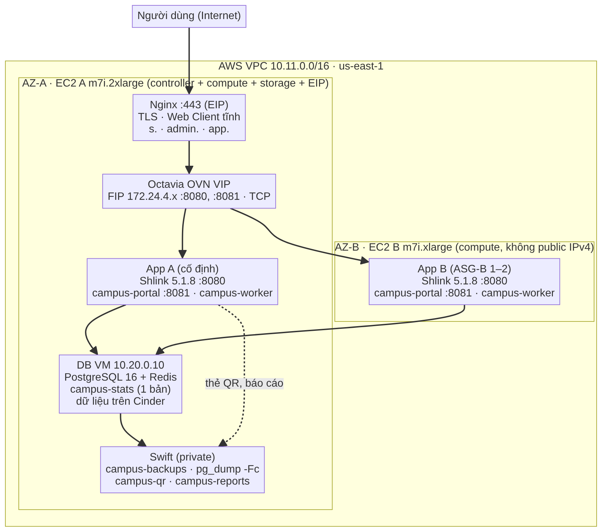

# SRS – CampusLink (Nhóm 11)

> Bản Markdown xuất ngày 22/10/2026 từ Claude Doc "SRS – CampusLink (Nhóm 11)". Khi sửa yêu cầu, giữ nguyên mã FR/NFR/O để các issue, PR và prompt cho AI agent tham chiếu đúng.
>
> **Bản 1.3 (02/11/2026, TV1):** thêm phần mở rộng ứng dụng sau nhận xét duyệt đề tài (mục 3.3, 4.6, NFR-17–19, ADR-08, ADR-09) và lịch mới của giảng viên (nộp 23/11, bảo vệ 30/11). Mã FR/NFR cũ giữ nguyên.
>
> **02/11/2026 (ADR-10, TV1):** chốt D3 và D4 (O-02, O-03): secret ứng dụng cất trong Swift `campus-secrets`, VM do ASG tạo lấy bằng application credential chỉ-đọc `campus-boot`. NFR-08 có một ngoại lệ duy nhất cho credential này (mục 4.6, NFR-08). **10/11/2026 (TV3, PR #30, TV1 chấp nhận):** thêm ngoại lệ thứ hai, hẹp: mật khẩu DB `shlink` và Redis trong user-data của DB VM `campus-db` (NFR-08). **12/11/2026 (TV1, #34, ADR-10):** thêm ngoại lệ thứ ba, hẹp: token signal của `OS::Heat::WaitConditionHandle` (`signal_transport: TOKEN_SIGNAL`) trong user-data của app VM; token chỉ signal được, không đọc secret nào (NFR-08).

**Có cần SRS không?** Có, nhưng là bản gọn để làm việc. Đề xuất nói *làm gì*, bản phân công nói *ai làm khi nào*, Lab TV1 nói *làm thế nào*; còn thiếu một chỗ đánh mã từng yêu cầu và ghi rõ phép thử PASS, để mỗi người (và AI agent khi "vibe code") nhìn một bảng là biết việc của mình xong hay chưa. Bản 1.0–1.2 chỉ tổng hợp từ 3 tài liệu nhóm; bản 1.3 thêm phạm vi mở rộng ứng dụng mà nhóm chốt ngày 02/11 (mục 3.3). Điểm chưa chốt nằm ở mục 7.

## 1. Giới thiệu

**Mục đích.** SRS này gom các yêu cầu đã rải trong đề xuất và bản phân công v1.1 thành một nơi duy nhất, có mã yêu cầu (FR/NFR) để mỗi thành viên biết mình phải làm gì, nhận gì từ ai và thế nào là PASS. SRS không thay thế bản phân công: phân công nói *ai làm, khi nào*; SRS nói *hệ thống phải làm được gì và đo thế nào*.

**Phạm vi.** CampusLink là dịch vụ rút gọn link cho trường, dùng Shlink v5.1.8 (backend) và Shlink Web Client v4.8.1 (UI) chạy trong Nova VM trên OpenStack DevStack stable/2026.1, lồng trong 2 EC2 AWS ở 2 AZ. Phạm vi gồm: tạo/sửa/chuyển hướng link, thống kê visit, QR, gắn tag theo chiến dịch, cân bằng tải, tự động mở rộng, lưu trữ block/object, sao lưu/khôi phục, phân quyền và đo hiệu năng. Từ bản 1.3 thêm ba dịch vụ nhóm tự viết bao quanh Shlink (ADR-08): cổng chiến dịch nhiều đơn vị `campus-portal`, worker xử lý job nền `campus-worker` (phát hành thẻ QR cá nhân hóa hàng loạt) và bộ thống kê thời gian thực `campus-stats` (check-in, số lượt theo phút). Ngoài phạm vi: viết lại backend/schema, Kubernetes/Magnum, chịu lỗi mất cả một AZ, bản đồ địa lý GeoLite, real-time Mercure.

**Thuật ngữ.**

| Thuật ngữ | Nghĩa trong SRS |
| --- | --- |
| Host A / Host B | EC2 A (controller + compute + gateway + storage, AZ-A) / EC2 B (compute, AZ-B) |
| App A / App B | Nova VM chạy container Shlink, đặt ở host A / host B |
| DB VM | VM 10.20.0.10 chứa PostgreSQL và Redis ứng dụng |
| VIP | Địa chỉ Octavia OVN LB trong mạng nội bộ OpenStack |
| short domain / admin domain | `s.CAMPUS_DOMAIN` (redirect) / `admin.CAMPUS_DOMAIN` (Web Client); `CAMPUS_DOMAIN` = `<EIP-gạch-ngang>.sslip.io`, xem mục 2 |
| app domain | `app.CAMPUS_DOMAIN`: cổng `campus-portal` (từ bản 1.3) |
| Đơn vị | CLB/khoa/phòng dùng portal; mỗi đơn vị một API key Shlink `--author-only` |
| Chiến dịch | Sự kiện hoặc đợt truyền thông trong portal; ánh xạ thành một tag Shlink |
| Job, lô | Việc nền trong hàng đợi `campus:jobs`; job phát hành thẻ được chia thành nhiều lô, mỗi lô do một worker xử lý |
| Gate G0–G5 | Cổng nghiệm thu theo lịch trong bản phân công |
| H0–H6 | Mốc bàn giao giữa các thành viên |
| PASS | Điều kiện cần đạt, chưa phải kết quả đã có |

**Tài liệu tham chiếu.**

- Đề xuất dự án CampusLink (4 trang) của Nhóm 11.
- CampusLink – Phân công chi tiết & kế hoạch phối hợp, bản 1.2 - Shlink, 22/10/2026 (`docs/references/`; bản 1.2 sửa theo SRS này).
- CampusLink – Lab TV1, bản 1.1, 22/10/2026.
- OpenAPI và HealthAction của Shlink v5.1.8 (nguồn S28–S29 trong bản phân công).
- Thông báo của giảng viên ngày 02/11/2026: kết quả duyệt đề tài (O-04) và lịch nộp mới (C-09).
- CampusLink: kế hoạch tăng độ phức tạp ứng dụng (Claude Doc của TV1, 02/11/2026): nguồn của mục 3.3, 4.6, ADR-08, ADR-09.

## 2. Mô tả tổng quan

**Bối cảnh.** Câu lạc bộ và đơn vị trong trường cần link ngắn/QR cho sự kiện, tài liệu và chiến dịch, cần đổi đích đến và xem lượt truy cập. Khi tải tăng hoặc một VM ứng dụng lỗi, dịch vụ vẫn phải chuyển hướng đúng và mở rộng được. Trọng tâm đánh giá là hạ tầng cloud. Sau nhận xét "ứng dụng có vẻ quá đơn giản" (O-04), bản 1.3 cho app nghiệp vụ thật: đơn vị tạo chiến dịch, phát hành thẻ QR riêng cho từng người tham dự, rồi theo dõi check-in trực tiếp khi mọi người quét thẻ ở cổng, đúng lúc tải tăng đột biến.

**Luồng chính.** Người dùng → EIP AWS → Nginx trên host A:443 (TLS) → floating IP nội bộ của VIP (172.24.4.x) → Octavia OVN TCP LB → App A / App B :8080 → PostgreSQL + Redis trên DB VM 10.20.0.10. Backup: `pg_dump` → Swift private → restore vào DB tách biệt.

**Luồng mở rộng (bản 1.3).** Ban tổ chức → Nginx `app.` → FIP của VIP:8081 → `campus-portal` trong mỗi app VM → REST Shlink qua `127.0.0.1:8080` bằng key của đơn vị; dữ liệu nghiệp vụ trong DB `campus_portal` trên DB VM. Job nặng (phát hành thẻ, nhập CSV, báo cáo) → Redis Stream `campus:jobs` → `campus-worker` trong mỗi app VM → Swift `campus-qr`, `campus-reports`. Visit → Shlink phát lên Redis pub/sub → `campus-stats` (một bản, trên DB VM) → bảng đếm trong DB `campus_portal` → portal đẩy SSE lên trình duyệt.

**Tác nhân.**

| Tác nhân | Vai trò | Kênh truy cập |
| --- | --- | --- |
| Người truy cập link | Mở link ngắn/QR, được chuyển hướng | `https://s.CAMPUS_DOMAIN/{shortCode}` |
| Người tham dự sự kiện (1.3) | Nhận thẻ có QR riêng; quét ở cổng là check-in | `https://s.CAMPUS_DOMAIN/{shortCode}` riêng từng người |
| Quản trị nội dung (CLB/đơn vị) | Tạo/sửa link, gắn tag, xem thống kê, tạo QR; từ bản 1.3 quản lý chiến dịch, phát hành thẻ | Portal `https://app.CAMPUS_DOMAIN` bằng tài khoản đơn vị (1.3); Web Client tại `https://admin.CAMPUS_DOMAIN` cho quản trị kỹ thuật, nhập API key riêng |
| Client API / script kiểm thử | Gọi REST v3 bằng `X-Api-Key` | Locust, smoke test, fixture |
| Quản trị cloud (TV1) | Quản trị AWS và OpenStack admin | SSH tới A, ProxyJump tới B |
| Thành viên dự án (TV2/TV3 member, TV4 reader) | Vận hành trong project `campuslink` | OpenStack CLI qua SSH, không public API |

**Ràng buộc.**

| Mã | Ràng buộc |
| --- | --- |
| C-01 | AWS us-east-1, 2 EC2 ở 2 AZ: A m7i.2xlarge (8 vCPU/32 GiB, public-A 10.11.0.10), B m7i.xlarge (4 vCPU/16 GiB, private-B 10.11.11.10, không public IPv4). Không thêm EC2. |
| C-02 | Ubuntu 24.04 LTS x86_64, DevStack stable/2026.1, khóa SHA từng repo sau smoke. Nested KVM bắt buộc; không benchmark trên QEMU. |
| C-03 | Neutron ML2/OVN, Octavia provider `ovn` (TCP, không Amphora), Heat + Ceilometer + Gnocchi + Aodh. |
| C-04 | Shlink v5.1.8 + Web Client v4.8.1, khóa image digest; không dùng `develop` hay `latest`. Không sửa backend/schema upstream. Phần mở rộng chỉ bao quanh Shlink qua REST và Redis, không fork (ADR-08). |
| C-05 | PostgreSQL 16 trên Cinder volume; Redis ứng dụng dùng chung, riêng với Redis của Gnocchi. Không SQLite khi có nhiều replica. |
| C-06 | Flavor: app 1 vCPU/2 GiB/10 GiB; DB 1 vCPU/2 GiB/10 GiB + Cinder 10 GiB; builder 2 vCPU/4 GiB tạm. Tổng app 2–3 VM. |
| C-07 | Quota project `campuslink`: 6 instance, 8 vCPU, 12 GiB RAM, 5 volume/30 GiB, 3 floating IP. |
| C-08 | Ngân sách lab mục tiêu 70 USD (kế hoạch 52–67 USD cho 40–60 giờ/EC2); EC2 chỉ bật theo phiên. |
| C-09 | Nộp (M4) 23/11/2026, bảo vệ (M5) 30/11/2026; giảng viên lùi lịch ngày 02/11 (trước là 09/11 và 16/11). Freeze 19–22/11. Không nâng phiên bản sau freeze. |

**Giả định và giới hạn đã chấp nhận.**

- Host A là điểm lỗi đơn của ingress, controller, gateway, Cinder/Swift và DB. Hệ thống không chịu được mất cả AZ-A (ADR-05).
- Octavia OVN chỉ có TCP monitor, không phát hiện API trả 500; HTTP readiness được kiểm trước khi đăng ký member.
- Autoscaling không được hứa là cải thiện hiệu năng; kết quả đo thật được báo cáo kể cả khi không cải thiện (ADR-06).
- Queue background của RoadRunner nằm trong bộ nhớ, nhưng chỉ chứa listener async (pub/sub cho `campus-stats`): visit của request **đã trả lời** được ghi vào PostgreSQL trong transaction của request, nên kill/scale-in chỉ có thể mất **sự kiện pub/sub**, không mất visit (đo và mã nguồn v5.1.8: `docs/handoffs/H1-shlink.md` mục 5.1). Request **đang xử lý** lúc kill chưa đo, nên vẫn không hứa exactly-once cho trường hợp đó.
- Chiến dịch do portal quản lý; mỗi chiến dịch ánh xạ thành một tag Shlink (ví dụ `campus-open-day`).
- Redis pub/sub không lưu tin: `campus-stats` tắt là mất sự kiện, nên số liệu được đối soát định kỳ với API visits (FR-APP-18). Redis thành điểm lỗi đơn của cache, sự kiện và hàng đợi job (ADR-09).

**Domain (chốt 22/10/2026, cập nhật cùng ngày).** Nhóm không mua domain. `CAMPUS_DOMAIN` = `<EIP-gạch-ngang>.sslip.io`, ví dụ EIP 3.91.10.20 → `3-91-10-20.sslip.io`. sslip.io là DNS công khai miễn phí, tự phân giải mọi tên dạng này về đúng IP, không cần đăng ký. Vì vậy `s.CAMPUS_DOMAIN` (link ngắn) và `admin.CAMPUS_DOMAIN` (Web Client) cùng trỏ về EIP của host A, và mọi máy trên Internet, kể cả điện thoại quét QR, phân giải được mà không sửa hosts. Chứng thư TLS lấy từ Let's Encrypt bằng certbot (HTTP-01, SAN chứa cả 2 tên). Cổng 80 trên EIP là Apache của DevStack (Keystone, Placement…), nên thử thách ACME do Apache trả qua webroot và SG chỉ mở 80 trong vài phút lúc cấp; cert hạn 90 ngày, cấp khoảng 27/10 là đủ tới bảo vệ, không cần gia hạn. Không dùng `curl -k` hay tắt TLS verification để báo PASS. EIP phải giữ cố định tới hết buổi bảo vệ: đổi EIP là đổi domain và mọi QR đã phát hành mất hiệu lực. Bản 1.3 thêm tên thứ ba `app.CAMPUS_DOMAIN`: cấp lại cert `campus` với `--expand`, mở SG 80 vài phút như lần đầu.

**Sơ đồ kiến trúc.** Host A gánh ingress, LB, DB và storage; host B chỉ chạy app.



*Nguồn sơ đồ (Mermaid, để sửa): `docs/images/kien-truc.mmd`.* Bản 1.3 thêm portal, worker trong mỗi app VM, `campus-stats` trên DB VM và hai container Swift mới.

Mọi request đi qua Nginx và VIP trên host A rồi mới tới app; vì vậy tắt app A chỉ là lỗi app, còn tắt EC2 A làm mất cả hệ thống. Guest dùng `campus-net` 10.20.0.0/24, Geneve nối A↔B.

## 3. Yêu cầu chức năng

Có 43 yêu cầu, chia 3 nhóm: chức năng ứng dụng Shlink mà người dùng thấy (FR-APP-01–12), chức năng hạ tầng mà môn học chấm (FR-INF, bám 8 hạng mục bắt buộc) và chức năng mở rộng do nhóm viết (FR-APP-13–21, bản 1.3). Mức ưu tiên: **P0** = thiếu thì trượt tiêu chí; **P1** = cần cho demo; **P2** = chưa dùng trong bản này. Cột "Kiểm bằng" là phép thử tối thiểu để ghi PASS.

### 3.1 Chức năng ứng dụng (Shlink + Web Client)

| Mã | Yêu cầu | Ưu tiên | Chủ trì | Kiểm bằng |
| --- | --- | --- | --- | --- |
| FR-APP-01 | Tạo link ngắn từ `longUrl`, cho phép `customSlug` và `tags`; trả `shortUrl` dạng `https://s.CAMPUS_DOMAIN/...` | P0 | TV3 | `POST /rest/v3/short-urls` → 200, `shortUrl` đúng domain HTTPS |
| FR-APP-02 | Chuyển hướng `GET /{shortCode}` bằng HTTP 302 với `Location` = `longUrl` | P0 | TV3 | curl không follow → 302 + Location đúng |
| FR-APP-03 | Sửa đích đến của link đã có; thay đổi có hiệu lực trên mọi replica | P0 | TV3 | `PATCH` rồi GET qua cả app A và app B → Location mới |
| FR-APP-04 | Ghi nhận visit cho mỗi lượt GET redirect và xem danh sách visit có phân trang | P0 | TV3 | `GET .../visits` sau khi đợi task nền, đếm khớp số GET (cùng bộ lọc bot/UA) |
| FR-APP-05 | Gắn tag chiến dịch và xem thống kê theo tag | P1 | TV3 | `GET /rest/v3/tags/stats` có tag `campus-open-day` với số link/visit |
| FR-APP-06 | Tạo QR cho short URL ngay trong Web Client (Shlink 5 không còn endpoint QR backend) | P1 | TV3 | Quét QR bằng điện thoại → mở đúng `shortUrl` |
| FR-APP-07 | Mọi API quản trị yêu cầu header `X-Api-Key`; thiếu/sai key bị từ chối | P0 | TV3 | Không key hoặc key sai → 401 |
| FR-APP-08 | Mỗi thành viên có API key riêng có tên; key `--author-only` chỉ thấy link do chính key tạo | P0 | TV3 | Key A không đọc được link riêng của key B |
| FR-APP-09 | Web Client chạy dạng SPA tĩnh tại admin domain; refresh route không 404; người dùng tự nhập server URL + key | P0 | TV3 (build), TV1 (Nginx) | Mở `https://admin.../` → thêm server → liệt kê link; F5 ở route con không 404 |
| FR-APP-10 | CORS chỉ cho phép origin admin domain gọi API với `X-Api-Key`, `Content-Type` | P0 | TV3 | Preflight `OPTIONS` từ origin admin → allow-origin đúng |
| FR-APP-11 | Endpoint health `GET /rest/health` trả 200/`pass` khi truy vấn DB được, 503/`fail` khi DB lỗi | P0 | TV3 | Dừng PostgreSQL → 503; bật lại → 200 |
| FR-APP-12 | Tài nguyên không tồn tại trả 404; tạo trùng slug trả 400 `non-unique-slug` | P1 | TV3 | Gọi slug không có; tạo 2 lần cùng slug |

### 3.2 Chức năng hạ tầng

| Mã | Yêu cầu | Ưu tiên | Chủ trì | Kiểm bằng |
| --- | --- | --- | --- | --- |
| FR-INF-01 | 2 EC2 ở 2 AWS AZ; VPC 10.11.0.0/16 với 4 subnet; B không public IPv4, ra Internet qua NAT trên A | P0 | TV1 | Ảnh EC2 AZ ID + route table; B `apt update` được |
| FR-INF-02 | Nested KVM hoạt động trên cả A và B | P0 | TV1 | `/dev/kvm`, `kvm-ok` trên 2 host |
| FR-INF-03 | 2 nova-compute up; 2 Nova AZ `campus-az-a`/`campus-az-b` ánh xạ đúng host A/B | P0 | TV1 | `openstack aggregate show`, VM tạo ở đúng host |
| FR-INF-04 | Mạng tenant `campus-net` 10.20.0.0/24 (MTU 1400) nối guest xuyên host qua Geneve; guest ra Internet qua SNAT router | P0 | TV1 | Ping DF 1372 byte + HTTP A↔B; curl ra ngoài từ guest |
| FR-INF-05 | App/DB VM không có floating IP; cổng 8080/5432/6379/API quản trị không truy cập được từ Internet | P0 | TV1/TV3 | Quét cổng từ máy ngoài VPC: chỉ 443 mở (22 mở theo ADR-07 tới freeze, sau đó chỉ từ /32; 80 chỉ mở lúc cấp cert) |
| FR-INF-06 | Ingress: EIP → Nginx A:443 (TLS) → FIP nội bộ của VIP:8080; admin domain phục vụ Web Client tĩnh | P0 | TV1 (+TV3 cert) | `curl https://s.../rest/health` từ Internet → 200 với cert hợp lệ, không `-k` |
| FR-INF-07 | Octavia provider `ovn`: listener TCP 8080, pool `SOURCE_IP_PORT`, TCP health monitor | P0 | TV2 | Nhiều kết nối mới đi tới cả 2 backend (log/capture từng guest) |
| FR-INF-08 | Heat giữ 1 app cố định ở AZ-A và ASG-B min 1/max 2 ở AZ-B (tổng 2–3 app) | P0 | TV2 | `templates/root.yaml`; manual policy 1→2→1 ở B |
| FR-INF-09 | Mỗi app unit: VM → readiness (health 200 + Redis PING có auth) → WaitCondition → PoolMember; xóa thì gỡ member trước VM | P0 | TV2 | Cố ý làm DB unreachable → stack fail, không thêm member |
| FR-INF-10 | Ceilometer thu metric CPU của VM app ở cả 2 host; Gnocchi lưu granularity 60 s; Aodh đánh giá ngưỡng và gọi scaling policy | P0 | TV2 | Có metric có đơn vị/timestamp cho VM A và B; alarm history có chuyển ALARM |
| FR-INF-11 | Tải thật kích hoạt scale-out 2→3 và scale-in 3→2 tự động | P0 | TV2 + TV4 | Timeline: load → ALARM → Heat event → VM ready → request đầu trên VM mới |
| FR-INF-12 | PostgreSQL 16 + Redis ứng dụng trên DB VM 10.20.0.10, dữ liệu PostgreSQL nằm trên Cinder volume 10 GiB | P0 | TV3 (TV1 cấp port/volume) | Reboot DB VM: link còn; thiếu mount thì PostgreSQL không chạy |
| FR-INF-13 | Cinder LVM backend trên EBS 30 GiB riêng, attach/detach giữ dữ liệu | P0 | TV1 | File test có checksum khớp sau detach/attach |
| FR-INF-14 | Swift container `campus-backups` private, upload/download đúng checksum | P0 | TV1 | Request không token bị từ chối (không phải timeout) |
| FR-INF-15 | Backup `pg_dump -Fc` → Swift theo lịch, có checksum/retention, thêm 1 bản về máy nhóm | P0 | TV3 | Object có trong Swift + checksum khớp bản local |
| FR-INF-16 | Restore vào DB tách biệt `campus_restore_test` (Redis namespace khác), cùng phiên bản Shlink | P0 | TV3 | Kiểm schema version, số bản ghi fixture và 5 slug/target đã chốt |
| FR-INF-17 | IAM role `CampusLinkBackup` gắn EC2 A, chỉ được `CreateSnapshot` volume đã duyệt với tag `Project=CampusLink` | P0 | TV1 | Dry-run: volume đúng → `DryRunOperation`; volume B → `UnauthorizedOperation`; 1 snapshot completed |
| FR-INF-18 | Keystone: project `campuslink`; TV2/TV3 `member`, TV4 `reader`; không có admin credential trong guest/app | P0 | TV1 | Reader tạo VM → 403; member tạo project → 403 |
| FR-INF-19 | Stop/start cả 2 EC2 theo runbook và khôi phục đủ dịch vụ mà không chạy lại `stack.sh` | P0 | TV1 | Bảng trước/sau: slug redirect, Swift checksum, Cinder file, UUID, digest, STS |
| FR-INF-20 | Khi tắt app VM A, LB loại backend lỗi và app B tiếp tục phục vụ | P1 | TV2 + TV4 | Fault run: thời gian phát hiện, 5xx/timeout, thời gian hồi phục |
| FR-INF-21 | Giám sát chi phí: budget cảnh báo 30/50/65 USD, ghi giờ chạy từng host | P1 | TV4 | `cost.csv` + ảnh budget |
| FR-INF-22 | Image app trên Glance có Docker + Shlink digest nạp sẵn, không chứa secret; scale-out không build/pull | P0 | TV2 | `image-manifest.json`; clone boot độc lập |

### 3.3 Chức năng mở rộng ứng dụng (bản 1.3)

Ba dịch vụ nhóm tự viết bao quanh Shlink (ADR-08): `campus-portal` (giao diện nghiệp vụ cho đơn vị, cổng 8081, chạy trong mỗi app VM), `campus-worker` (cùng image với portal, khác entrypoint, chạy trong mỗi app VM nên co giãn cùng ASG) và `campus-stats` (một bản trên DB VM). Ở mục này **P0** = phải có trong demo bảo vệ; **P1** bỏ được ở mốc cắt 14/11; **P2** làm nếu còn thời gian. Đường lùi của P0 ghi ngay trong yêu cầu.

| Mã | Yêu cầu | Ưu tiên | Chủ trì | Kiểm bằng |
| --- | --- | --- | --- | --- |
| FR-APP-13 | Portal có tài khoản và 3 vai trò (quản trị, đơn vị, người xem). Mỗi đơn vị gắn một API key Shlink `--author-only` riêng, lưu mã hóa trong DB `campus_portal` | P0 | TV3 | Đơn vị A không thấy chiến dịch, link, số liệu của B, cả qua portal lẫn gọi thẳng REST bằng key của A |
| FR-APP-14 | Chiến dịch: tạo, sửa, đóng; link thuộc chiến dịch mang tag của chiến dịch và có thời gian hiệu lực | P0 | TV3 | Tạo chiến dịch có 3 link; hết hạn thì link không còn chuyển hướng tới đích |
| FR-APP-15 | Nhập link hàng loạt từ CSV (chạy như job FR-APP-21), báo kết quả từng dòng (ví dụ `non-unique-slug`); nhập lại cùng file không tạo trùng | P0 | TV3 | File 200 dòng có 5 dòng lỗi cố ý: 195 link, 5 dòng báo lỗi; nhập lại: 0 link mới |
| FR-APP-16 | Phát hành thẻ QR cá nhân hóa: nhập danh sách người tham dự, mỗi người một short link gắn tag chiến dịch; job chia lô (FR-APP-21) dựng PDF thẻ từ mẫu (tên, đơn vị, QR riêng), lô cuối xong thì job gộp tạo file tổng; lưu container Swift riêng tư `campus-qr`, tải qua portal. Đường lùi tới 10/11: 1 lô, không cá nhân hóa | P0 | TV3 (mẫu, hàm dựng thẻ), TV4 (chia lô, gộp) | Danh sách N người ra N thẻ với N link khác nhau, các lô chạy trên nhiều worker; quét QR bằng điện thoại mở đúng link; object Swift không token bị từ chối |
| FR-APP-17 | Luật chuyển hướng đặt từ portal: theo thiết bị (Android/iOS), ngôn ngữ, trước/sau một mốc giờ (`before-date`, `after-date` của Shlink 5) | P1 | TV3 | Cùng link: User-Agent Android và iOS ra 2 `Location` khác nhau; sau mốc giờ ra đích thứ ba |
| FR-APP-18 | Thống kê thời gian thực: `campus-stats` nhận visit qua Redis pub/sub, cộng theo phút và chiến dịch, đếm số người đã check-in (số link riêng đã được quét); portal đẩy lên bảng bằng SSE; đối soát định kỳ với API visits để bù sự kiện mất | P0 | TV4 | Chạy tải: số trên bảng tăng theo; tắt `campus-stats` 2 phút rồi bật lại: sau đối soát, tổng khớp API visits |
| FR-APP-19 | Báo cáo chiến dịch xuất CSV (job FR-APP-21), lưu Swift `campus-reports` | P1 | TV4 | Tổng trong CSV khớp `GET /rest/v3/tags/{tag}/visits` |
| FR-APP-20 | Nhật ký thao tác của portal (ai, làm gì, lúc nào) | P2 | TV3 | Mỗi thao tác tạo/sửa/xóa có một dòng |
| FR-APP-21 | Hàng đợi job bền: portal ghi job vào Redis Stream `campus:jobs`; `campus-worker` đọc bằng consumer group, `XACK` khi xong, `XAUTOCLAIM` job treo quá 60 s của worker đã chết; job idempotent (tên object cố định), tối đa 3 lần thử rồi chuyển `failed`; trạng thái job trong DB `campus_portal` | P0 | TV4 (khung hàng đợi, worker), TV3 (hàm xử lý) | Phát hành 300 thẻ: `docker kill` worker đang xử lý ở VM 1, worker VM 2 làm xong; đủ 300 thẻ, không trùng object; job lỗi 3 lần hiện `failed` trên portal |

Chưa kiểm trên cụm, phải thử trước khi dựa vào: topic và payload sự kiện visit (O-12), nhiều listener trên một LB OVN (O-13), access rules của application credential (O-14).

## 4. Hợp đồng giao diện (API, cấu hình, bàn giao)

Hợp đồng này chốt trước 23/10 và là thứ TV2 (readiness, image), TV4 (smoke, Locust) và Web Client cùng dựa vào. Nguồn gốc là OpenAPI và HealthAction của Shlink **v5.1.8**; khi SRS và OpenAPI khác nhau, OpenAPI thắng và SRS phải sửa. Không tự suy endpoint từ tên dự án. Phần bản 1.3 (mục 4.6 và các dòng đánh dấu 1.3) chốt trước 05/11.

### 4.1 REST API dùng trong dự án

| API | Auth | Kết quả đúng | Bên dùng |
| --- | --- | --- | --- |
| `GET /rest/health` | Không | 200 + JSON `status=pass` khi truy vấn DB được; 503/`fail` khi DB lỗi. **Không kiểm Redis** | TV2 readiness, TV4 synthetic check |
| `GET /{shortCode}` | Không | 302 + `Location` (vì `REDIRECT_STATUS_CODE=302`); client test không follow | Locust, trình duyệt |
| `POST /rest/v3/short-urls` | `X-Api-Key` | 200 theo spec; body chứa `shortUrl` | Web Client, fixture, TV4 |
| `PATCH /rest/v3/short-urls/{shortCode}` | `X-Api-Key` | Đổi `longUrl`; kiểm qua cả 2 backend | Web Client, TV4 |
| `GET /rest/v3/short-urls/{shortCode}/visits` | `X-Api-Key` | Danh sách visit phân trang; mọi lượt đo dùng cùng bộ lọc bot/thời gian/domain | Web Client, tải đọc |
| `GET /rest/v3/tags/stats` | `X-Api-Key` | Thống kê link/visit theo tag | Demo chiến dịch |
| `GET /rest/v3/tags/{tag}/visits` | `X-Api-Key` | Visit theo tag chiến dịch | `campus-stats` đối soát, FR-APP-19 (1.3) |
| `POST /rest/v3/short-urls/{shortCode}/redirect-rules` | `X-Api-Key` | Đặt bộ luật chuyển hướng của một link | Portal, FR-APP-17 (1.3) |
| `OPTIONS /rest/v3/...` | Không | Preflight cho origin `https://admin.CAMPUS_DOMAIN`, cho phép `X-Api-Key`, `Content-Type` | Web Client |

Từ bản 1.3, `campus-portal` và `campus-worker` gọi các API trên qua `http://127.0.0.1:8080` trên cùng app VM, bằng key của đơn vị đang thao tác; `campus-stats` gọi qua VIP nội bộ cổng 8080.

Mã lỗi cần xử lý: 401 (thiếu/sai key), 400 `non-unique-slug` (trùng slug), 404 (slug không có; `/` cũng có thể 404 vì chưa cấu hình base redirect), 503 (health khi DB lỗi). Trong benchmark: 302 và create 200 là thành công, 5xx/timeout là lỗi, 4xx ghi riêng.

Ví dụ gọi (đã dùng trong smoke Lab 9.8; key nhập bằng `read -rsp`, không in ra log):

```bash
curl --fail-with-body -sS "$CAMPUS_SHORT/rest/v3/short-urls" \
  -H "X-Api-Key: $CAMPUS_API_KEY" -H 'Content-Type: application/json' \
  --data '{"longUrl":"https://example.org/","customSlug":"tv1-20261025T0900","tags":["campus-smoke"]}'
curl -sS -D - -o /dev/null "$CAMPUS_SHORT/tv1-20261025T0900"   # mong đợi 302
curl --fail-with-body -sS -X PATCH "$CAMPUS_SHORT/rest/v3/short-urls/tv1-20261025T0900" \
  -H "X-Api-Key: $CAMPUS_API_KEY" -H 'Content-Type: application/json' \
  --data '{"longUrl":"https://example.org/?campus=updated"}'
```

### 4.2 Quy tắc về API key

- Key tạo bằng `shlink api-key:generate --name=<tên> [--author-only]` trong container đang chạy; key lưu trong DB nên dùng được trên mọi replica. Chỉ thấy plaintext một lần lúc tạo.
- Key không có role = quyền admin ứng dụng. Shlink **không có** cặp role read/write; `--author-only` dùng cho phép thử phân tách dữ liệu, `--domain-only` chỉ khi đủ điều kiện domain của upstream.
- TV3 giữ 1 key admin để chuẩn bị fixture chung. Nếu fixture tạo bằng key hạn chế, TV4 phải dùng chính key đó khi đo thống kê.
- Web Client lưu server/key trong local storage của trình duyệt: không đặt key thật vào `servers.json` hay `SHLINK_SERVER_API_KEY` của UI public. CORS không phải cơ chế phân quyền.
- Bản 1.3: mỗi đơn vị một key `--author-only` do TV3 tạo bằng CLI; portal lưu key đã mã hóa bằng `PORTAL_SECRET_KEY`. `campus-stats` dùng một key riêng tên `campus-stats` để đọc visit của mọi tag; Shlink không có role chỉ-đọc nên đây là key admin ứng dụng, giữ như secret (NFR-18). Key có role không đổi tên/xóa tag được, nên tên tag của chiến dịch đặt một lần lúc tạo.

### 4.3 Hợp đồng cấu hình container (TV3 → TV2)

Container `shlinkio/shlink:5.1.8` (sau smoke khóa bằng RepoDigest thật), nghe cổng 8080, chạy cả web và background worker. File `/opt/campuslink/shlink.env` baseline:

```
DEFAULT_DOMAIN=s.CAMPUS_DOMAIN
IS_HTTPS_ENABLED=true
PORT=8080
DB_DRIVER=postgres
DB_HOST=10.20.0.10
DB_PORT=5432
DB_NAME=shlink
DB_USER=shlink
DB_PASSWORD_FILE=/run/secrets/db_password
REDIS_SERVERS_FILE=/run/secrets/redis_servers
CACHE_NAMESPACE=campuslink-v5
REDIS_PUB_SUB_ENABLED=true
MERCURE_ENABLED=false
RABBITMQ_ENABLED=false
AUTO_RESOLVE_TITLES=false
SKIP_INITIAL_GEOLITE_DOWNLOAD=true
REDIRECT_STATUS_CODE=302
WEB_WORKER_NUM=1
TASK_WORKER_NUM=1
MEMORY_LIMIT=256M
TIMEZONE=UTC
LOGS_FORMAT=json
CORS_ALLOW_ORIGIN=https://admin.CAMPUS_DOMAIN
TRUSTED_PROXIES=1
```

- Secret chỉ đi qua file `_FILE` (bind-mount read-only, mode 0444, thư mục cha 0700/root); không đặt thêm biến thường chứa secret vì biến thường được ưu tiên. `redis_servers` có dạng `tcp://default:<password-urlencoded>@10.20.0.10:6379`.
- Entrypoint chạy installer/migration mỗi lần khởi động: instance đầu tiên phải xong trước khi thêm replica; không sửa entrypoint để bỏ migration. Timeout khởi động pilot 180 s.
- Bản 1.3 đổi `REDIS_PUB_SUB_ENABLED` sang `true` để Shlink phát sự kiện visit lên Redis (FR-APP-18, ADR-09); tính năng này chỉ chạy với RoadRunner, là runtime của image Docker.
- Worker/memory là điểm xuất phát để đo trên guest 1 vCPU/2 GiB, không phải cấu hình hiệu năng đã chứng nhận.

### 4.4 Ingress và cổng mạng

| Đường | Nguồn → đích | Cổng | Ghi chú |
| --- | --- | --- | --- |
| Người dùng → Nginx | Internet → EIP A | TCP 443 | 3 virtual host theo SNI/Host (`app.` từ bản 1.3). Không có cổng 80 cho người dùng: 80 trên A là Apache của DevStack, chỉ mở SG 80 vài phút khi certbot cấp cert (ACME HTTP-01 qua webroot của Apache) |
| Nginx → VIP | A → FIP nội bộ 172.24.4.x | TCP 8080 | `Connection close`, `proxy_next_upstream off` (không retry POST), ghi đè `X-Forwarded-For` |
| Nginx → VIP (1.3) | A → FIP nội bộ 172.24.4.x | TCP 8081 | Vhost `app.` → listener 8081 → pool portal. SSE: `proxy_buffering off`, `proxy_read_timeout` dài, **không** `Connection close`; `limit_req` cho trang đăng nhập |
| VIP → app | OVN LB → guest | TCP 8080 | SG `campus-app-sg` nhận từ 10.20.0.0/24 và 172.24.4.0/24 |
| VIP → portal (1.3) | OVN LB → guest | TCP 8081 | SG `campus-app-sg` thêm 8081 từ 10.20.0.0/24 và 172.24.4.0/24 |
| App → DB | `campus-app-sg` → `campus-db-sg` | TCP 5432, 6379 | Chỉ từ app SG |
| Portal, worker, stats → DB (1.3) | `campus-app-sg` → `campus-db-sg`; `campus-stats` chạy ngay trên DB VM | TCP 5432, 6379 | DB `campus_portal` với user riêng; cùng Redis có auth |
| Portal, worker → Swift (1.3) | guest → endpoint Swift trên A (H3, inventory) | theo endpoint | Application credential `campus-svc`, chỉ container `campus-qr`, `campus-reports` |
| Quản trị | Internet → A (ADR-07, tới freeze 19/11), sau đó IP /32 của thành viên | TCP 22 | Chỉ key, fail2ban, user Linux riêng; B qua ProxyJump; guest qua diag jump tạm |
| Overlay | A ↔ B | UDP 6081 Geneve, TCP 6641/6642 OVN, 5672 Rabbit, 3306 SQL | Chỉ trong SG `campus-hosts` |

### 4.5 Các mốc bàn giao H0–H6

| Mốc | Giao → nhận | Nội dung phải có (không chỉ "đã xong") |
| --- | --- | --- |
| H0 | TV1 → cả nhóm | inventory, kiến trúc mạng, phiên bản, lịch sử dụng cloud, SSH cá nhân |
| H1 | TV3 → TV2, TV4 | Shlink digest, API v3, `/rest/health` + Redis probe, cách cấp secret, worker config, migration/drain |
| H1b (1.3) | TV3 → TV2 | Image `campus-portal` (portal + worker) có digest, biến môi trường mục 4.6, `GET /healthz`, migration DB `campus_portal`, cách cấp secret |
| H2 | TV1 → TV2, TV3 | project, network/subnet/router UUID, AZ, flavor, keypair, quota, SG, endpoint private |
| H3 | TV1 → TV3 | Cinder service/backend, volume type/AZ, Swift auth endpoint, DB port 10.20.0.10; smoke attach/upload |
| H3b (1.3) | TV1 → TV3, TV4 | Container Swift `campus-qr`, `campus-reports`; user `campus-svc` + application credential (TV1 ghi vào Swift `campus-secrets/app/swift_app_cred`, ADR-10, không qua chat); cert có `app.`; vhost `app.` |
| H4 | TV2 → TV3, TV4 | VIP port/UUID, pool, image UUID, Heat params, thủ tục scale/disable alarm |
| H4b (1.3) | TV2 → TV3, TV4 | Listener/pool 8081 và FIP của VIP; image UUID mới có portal + worker; readiness chờ cả `/rest/health` và `/healthz` |
| H5 | TV3 → TV4 | fixture, backup snapshot ID, restore checklist, expected outputs |
| H6 | TV4 → cả nhóm | raw metrics, lỗi tái lập được, chênh lệch so với mục tiêu; độ trễ bảng (NFR-17), thời gian phát hành theo số worker (NFR-19) |

### 4.6 Hợp đồng dịch vụ mở rộng (bản 1.3)

Tên biến và đường dẫn dưới đây là đề xuất để TV2, TV3, TV4 làm song song; người chủ trì đổi được nhưng phải sửa mục này trong cùng PR.

| Dịch vụ | Chạy ở | Cổng | Health | Ghi chú |
| --- | --- | --- | --- | --- |
| `campus-portal` | Mỗi app VM, cạnh Shlink | 8081 | `GET /healthz` 200 khi DB `campus_portal` và Redis trả lời | Gọi Shlink qua `127.0.0.1:8080`; SSE ở `GET /events/campaigns/{id}` |
| `campus-worker` | Mỗi app VM (cùng image portal, `ROLE=worker`) | Không mở | Container `running`; job của worker chết được worker khác nhận lại | Xử lý một job một lúc, có `mem_limit` |
| `campus-stats` | DB VM, đúng một bản | Không mở | Log JSON mỗi phút: số sự kiện nhận, độ lệch đối soát | Không đặt trong image app (chạy hơn một bản sẽ đếm gấp đôi) |

Biến môi trường (secret chỉ qua `_FILE`, quy tắc như mục 4.3):

```
# campus-portal và campus-worker
ROLE=portal                                   # hoặc worker
PORTAL_PORT=8081
SHLINK_API_URL=http://127.0.0.1:8080
PORTAL_DB_URL_FILE=/run/secrets/portal_db_url
PORTAL_SECRET_KEY_FILE=/run/secrets/portal_secret_key   # mã hóa API key của đơn vị
REDIS_SERVERS_FILE=/run/secrets/redis_servers           # cùng file với Shlink
JOB_STREAM=campus:jobs
JOB_GROUP=campus-workers
JOB_CLAIM_IDLE_MS=60000
JOB_MAX_ATTEMPTS=3
BATCH_SIZE=100
OS_AUTH_URL=http://10.11.0.10/identity
SWIFT_APP_CRED_FILE=/run/secrets/swift_app_cred        # id + secret application credential campus-svc
SWIFT_CONTAINER_QR=campus-qr
SWIFT_CONTAINER_REPORTS=campus-reports
TIMEZONE=UTC
LOGS_FORMAT=json

# campus-stats
STATS_DB_URL_FILE=/run/secrets/stats_db_url
REDIS_SERVERS_FILE=/run/secrets/redis_servers
SHLINK_API_URL=http://<VIP nội bộ>:8080
SHLINK_API_KEY_FILE=/run/secrets/stats_api_key
RECONCILE_INTERVAL_S=60
```

- Sự kiện visit: Shlink phát lên Redis pub/sub theo topic trong Async API spec của v5.1.8. Phải đối chiếu tên topic và payload (có short code, tag hay không) trước khi viết `campus-stats` (O-12).
- Mỗi entry trong Stream có `job_id`, `type` (`issue_cards`, `issue_cards_merge`, `import_csv`, `report`), `campaign_id`, `unit_id`, `batch` (nếu có). Dữ liệu lớn (CSV, danh sách người tham dự) nằm trong DB `campus_portal`, không đưa vào Stream.
- Object Swift: `campus-qr/<campaign_id>/v<phiên bản>/lo-<n>.pdf` và `campus-qr/<campaign_id>/v<phiên bản>/tong.pdf`; `campus-reports/<campaign_id>/<yyyymmddThhmmZ>.csv`. Tên cố định để chạy lại thì ghi đè.
- Secret mới thuộc NFR-08: mật khẩu DB `campus_portal`, `PORTAL_SECRET_KEY`, application credential `campus-svc`, key `campus-stats`. Không đưa vào image, Heat output, user-data hay evidence; chúng nằm trong Swift `campus-secrets/app/` và VM lấy lúc boot bằng credential `campus-boot` (ADR-10).

## 5. Yêu cầu phi chức năng

Mọi con số dưới đây là **mục tiêu cần đo**, không phải kết quả đã có. Nếu không đạt, nhóm công bố số đo và phân tích; không đổi ngưỡng sau khi xem kết quả.

| Mã | Loại | Yêu cầu đo được | Chủ trì |
| --- | --- | --- | --- |
| NFR-01 | Hiệu năng | p95 redirect ≤ 500 ms ở mức thực đạt khoảng 30 RPS (đo qua Internet, đã gồm network latency) | TV4 |
| NFR-02 | Tin cậy | Tỷ lệ 5xx/timeout < 1% trong lượt không gây lỗi | TV4 |
| NFR-03 | Workload | Profile 80% `GET /{shortCode}`, 15% `GET .../visits`, 5% `POST /rest/v3/short-urls`; mức 10/30/60 RPS mục tiêu; warm-up 2 phút, steady 5 phút mỗi mức. Bản 1.3 thêm hồ sơ check-in (nhiều slug, mỗi slug vài lượt) để so với hồ sơ slug nóng; lượt benchmark redirect chạy khi không có job worker | TV4 |
| NFR-04 | Thực nghiệm | So static (2 app, 1/AZ) với auto (1 app AZ-A + ASG-B 1–2); mỗi cấu hình ≥ 3 lượt, đảo thứ tự; cùng digest, image UUID, fixture, config | TV4 |
| NFR-05 | Co giãn | Scale-out khi CPU > 60% qua 2 cửa sổ 60 s; scale-in khi < 25% qua 3 cửa sổ 60 s; cooldown ≥ 180 s. CPU phải quy đổi từ ns: % = Δcpu_ns / (Δt × 10^9 × N vCPU) × 100 | TV2 |
| NFR-06 | Co giãn | Đo và báo cáo riêng: thời điểm ALARM, VM ACTIVE, app ready, request đầu tiên tới VM mới | TV2 + TV4 |
| NFR-07 | Sẵn sàng | Mất app VM A không làm mất dịch vụ; đo thời gian phát hiện, lỗi trong lúc chuyển và thời gian hồi phục. Không cam kết chịu mất EC2 A/AZ-A | TV2 |
| NFR-08 | Bảo mật | Không secret trong Git, Glance image, Heat output, evidence, user-data (ngoại lệ: (1) application credential bootstrap `campus-boot`, chỉ-đọc, theo ADR-10; (2) mật khẩu DB `shlink` và Redis trong user-data của DB VM `campus-db`: VM tạo tay một lần, không thuộc ASG, chỉ root trong VM gọi được metadata, `member`/`reader` không thấy `user_data` qua Nova API, `docs/runbooks/db-vm.md`; (3) token signal của `OS::Heat::WaitConditionHandle` (`signal_transport: TOKEN_SIGNAL`) cho WaitCondition của app VM: token của stack user (role `heat_stack_user`, hạn 3600 s) chỉ signal được, không đọc Swift, Keystone, Nova hay Heat; vào VM qua user-data, ghi file root 0600 và xóa sau khi signal, không đưa vào Heat output, theo ADR-10 và #34; cả ba vẫn cấm trong Git và evidence); `.gitignore` chặn `.env`, `*.pem`, `local.conf`, `clouds.yaml`, `*.dump`, `*.sql` | Cả nhóm |
| NFR-09 | Bảo mật | Ba lớp quyền tách biệt: AWS IAM (EC2 A gọi AWS API), Keystone (người/dịch vụ trong OpenStack), Shlink API key (người dùng app). IMDSv2 bắt buộc, hop limit 1; guest không lấy được credential IAM của host | TV1 |
| NFR-10 | Bảo mật | Chứng thư Let's Encrypt hợp lệ cho cả 2 tên, còn hạn; không dùng `curl -k` để báo PASS | TV1 + TV3 |
| NFR-11 | Bền dữ liệu | Dữ liệu link còn nguyên sau reboot DB VM và sau stop/start cả 2 EC2; luôn có ít nhất 1 bản dump ngoài host A | TV3 |
| NFR-12 | Nhất quán | Link tạo/sửa qua app A đọc được qua app B; tất cả replica dùng cùng DB, cùng Redis, cùng `CACHE_NAMESPACE` | TV3 |
| NFR-13 | Tài nguyên | Không OOM/swap kéo dài khi chạy 3 app + DB; reserve A 16 GiB/4 vCPU, B 8 GiB/1 vCPU; allocation ratio 1.0 | TV1 + TV2 |
| NFR-14 | Tái lập | Khóa SHA mọi repo OpenStack, Gnocchi commit, Shlink digest, Web Client checksum, image UUID trong `versions.lock`; một người khác đọc runbook chạy lại được smoke | TV4 |
| NFR-15 | Quan sát | Log JSON, UTC, Request ID Shlink, guest UUID/IP trên mỗi replica; metric có đơn vị, timestamp, resource | TV2 + TV3 |
| NFR-16 | Chi phí | Lab ≤ 70 USD mục tiêu (công thức: (0,615 × H + 18,56) × 1,2, H = giờ mỗi EC2); báo cáo thêm kịch bản 730 giờ/tháng (562,32 USD gồm dự phòng 20%) | TV4 |
| NFR-17 | Hiệu năng (1.3) | Độ trễ từ lúc redirect tới lúc số hiện trên bảng portal; ngưỡng chốt sau pilot, đề xuất p95 ≤ 5 s ở 60 RPS | TV4 |
| NFR-18 | Bảo mật (1.3) | Cách ly dữ liệu giữa các đơn vị (phép thử FR-APP-13) và giữ bí mật của dịch vụ mới theo NFR-08; quét repo và image không có secret | TV4 (kiểm), TV3 |
| NFR-19 | Co giãn (1.3) | Phát hành N thẻ: đo thời gian xong với số worker cố định (2) và khi ASG thêm worker; báo cáo thời điểm worker mới nhận lô đầu tiên. N chọn sau khi đo thời gian scale-out ở G4 (O-16) | TV4 + TV2 |

**Không được làm để đạt số:** chèn tác vụ CPU giả vào endpoint, gửi Heat signal SUCCESS thủ công rồi gọi là autoscaling tự động, hạ threshold để chữa thiếu metric, benchmark trên QEMU như KVM, đếm visit bằng HEAD, chạy đo đồng thời với build/backup lớn, chạy job phát hành thẻ trong lượt benchmark redirect rồi gọi đó là tải redirect, nhét vòng lặp CPU giả vào worker để kéo dài job.

## 6. Tiêu chí nghiệm thu theo thành viên

Mỗi thành viên "xong" khi mọi mã yêu cầu mình chủ trì có bằng chứng trong `evidence/` và người review chéo đã **chạy hoặc quan sát** phép thử, không chỉ đọc ảnh. Bảng dưới gộp yêu cầu ở mục 3–5 theo người; task chi tiết (T1.xx…T4.xx) vẫn nằm trong bản phân công.

### 6.1 Phạm vi và định nghĩa hoàn thành

| Thành viên | Yêu cầu chủ trì | Nhận đầu vào | Hoàn thành khi | Review chéo bởi |
| --- | --- | --- | --- | --- |
| TV1 – Lương Đức Kiên (nền, mạng) | FR-INF-01–06, 13, 14, 17–19; NFR-09, 10, 13 | — (bắt đầu chuỗi) | G0–G2 PASS; TV2/TV3 tự dùng project mà không cần TV1 đăng nhập admin hộ; stop/start thật giữ link/object/volume; bản 1.3: vhost `app.` có SSE, cert có `app.`, container Swift `campus-qr`/`campus-reports`, `campus-svc` + application credential (H3b), SRS và ADR cập nhật | TV4 |
| TV2 – Nguyễn Công Huy Hoàng (LB, image, scaling) | FR-INF-07–11, 20, 22; NFR-05–07 | H2 từ TV1, H1 và H1b từ TV3 (trước đó dùng HTTP stub) | 2→3→2 bằng tải thật có alarm history, Heat events, member lifecycle, request tới app mới; fault run có số đo; bản 1.3: listener 8081, image có portal + worker, readiness chờ cả hai (H4b); phối hợp NFR-19 | TV1 (quyền, Heat scope) |
| TV3 – Đinh Quang Huy (ứng dụng, dữ liệu) | FR-APP-01–17, 20 (FR-APP-16: mẫu và hàm dựng thẻ), FR-INF-12, 15, 16; NFR-11, 12 | H2, H3, H3b từ TV1 (trước đó chạy Compose local) | Create → QR → 302 → edit → visits chạy qua 2 replica; backup/restore tách biệt PASS; manifest giao TV2 không chứa secret; bản 1.3: đăng nhập → chiến dịch → nhập CSV → phát hành thẻ chạy trên cụm (H1b) | TV2 (image, readiness) |
| TV4 – Cao Song Toàn (kiểm thử, chi phí) | FR-APP-18, 19, 21 (khung hàng đợi, chia lô); FR-INF-21; NFR-01–04, 14, 16–19; phối hợp NFR-06, 07 | H4, H4b từ TV2, H5 từ TV3, H3b từ TV1 | Acceptance matrix đủ 8 tiêu chí; raw CSV + metadata mỗi lượt; `cost.csv`; người ngoài đọc runbook chạy lại được smoke; bản 1.3: bảng check-in khớp API visits sau đối soát, có số đo NFR-17 và NFR-19 | TV3 (dữ liệu, workload) |

### 6.2 Ma trận 8 hạng mục bắt buộc

| Hạng mục | Yêu cầu liên quan | Chủ trì | Bằng chứng bắt buộc |
| --- | --- | --- | --- |
| 1. Mạng, 2 AZ | FR-INF-01–04 | TV1 | EC2 AZ ID + Nova host/AZ mapping; route table; VM A/B; overlay test |
| 2. Ứng dụng private | FR-INF-05, 06 | TV1/TV3 | Không FIP cho app/DB; B không public IPv4; SG; thử TCP public bị chặn |
| 3. Hai loại storage | FR-INF-13, 14; FR-APP-16, 19 (1.3) | TV3/TV1 | Cinder mount; Swift private put/get; dữ liệu còn sau reboot; app ghi Swift bằng application credential (1.3) |
| 4. Cơ sở dữ liệu | FR-INF-12, 15, 16; NFR-12 | TV3 | 2 app nhất quán; giới hạn pool; dump và restore tách biệt |
| 5. IAM / quyền | FR-INF-17, 18; FR-APP-07, 08, 13; NFR-18 (1.3) | TV1 | Instance profile; STS role; allow/deny; Keystone reader/member; đơn vị cách ly, application credential có access rules (1.3) |
| 6. LB + autoscaling | FR-INF-07–09, 11; NFR-19 (1.3) | TV2 | 2→3→2; alarm, Heat events, member lifecycle, request tới app mới; worker trên VM mới nhận lô (1.3) |
| 7. Monitoring + alarm | FR-INF-10; NFR-15; FR-APP-18, NFR-17 (1.3) | TV2/TV4 | Metric có đơn vị/timestamp/resource; alarm transition; host metrics |
| 8. Dự toán | FR-INF-21; NFR-16 | TV4 | Giá nguồn + ngày; actual usage; lab và 730 giờ; credit tách biệt |

### 6.3 Cổng nghiệm thu theo lịch

| Ngày | Gate | Phải có | Người dẫn |
| --- | --- | --- | --- |
| 21–23/10 | G0 | Account/quota/credit, KVM cả 2 host, B ra Internet | TV1 + TV4 |
| 23–25/10 | G1 | 2 nova-compute; guest A↔B; smoke OVN LB; 1 metric/Heat resource | TV1 + TV2 |
| 25–26/10 | G2 | Network/role/storage smoke; chạy lại được sau stop/start | TV1 + TV3 + TV4 |
| 02–05/11 | G3 | App thật 2 replica, backup/restore, TLS, manual scaling | TV2 + TV3 |
| 03–09/11 | Mở rộng (Compose) | Portal, worker, stats chạy trên Compose local (mục 3.3, 4.6) | TV3 + TV4 |
| 06–09/11 | G4 | Tải thật → alarm → VM ready → traffic → scale-in; đo thời gian scale-out (đầu vào NFR-19) | TV2 + TV4 |
| 10/11 | Mốc cắt 1 | MVP mở rộng chạy trên Compose; FR-APP-16 chưa chia lô được thì lùi về 1 lô | Cả nhóm |
| 10–14/11 | Mở rộng lên cụm | Listener 8081, vhost `app.`, image có portal + worker, Swift `campus-qr`/`campus-reports`, `campus-svc` | TV1 + TV2 + TV3 |
| 14/11 | Mốc cắt 2 | Phần mở rộng chưa ổn trên cụm thì rút khỏi demo, chỉ giữ trong báo cáo | TV1 chốt |
| 15–18/11 | G5 | Benchmark 3 lượt, fault run, NFR-17, NFR-19, giới hạn, chi phí | TV4 |
| 19–22/11 | Freeze | Diễn tập, video, kiểm đủ 8 tiêu chí, thu SSH về /32 | TV1 chốt |
| 23/11 | Nộp (M4) | Mã nguồn/cấu hình, báo cáo, video | Cả nhóm |
| 30/11 | Bảo vệ (M5) | Không nâng phiên bản phút cuối | Cả nhóm |

**Cập nhật lịch 22/10/2026.** G0 trễ khoảng 1 ngày (chưa bật EC2) nên G0–G3 dời như bảng trên; từ G4 giữ nguyên. Phần trễ bù bằng việc TV2/TV3/TV4 làm trước phần không cần cloud.

**Cập nhật lịch 02/11/2026.** Giảng viên lùi nộp sang 23/11 và bảo vệ sang 30/11. G3 trễ vì H1 chưa có (issue #11), nên G3–G5 dời như bảng; phần mở rộng (mục 3.3) làm trên Compose song song G3, G4 và chỉ lên cụm 10–14/11.

- **Mốc quyết định 25/10:** G1 chưa PASS → cả nhóm họp cắt phạm vi.
- **Mốc quyết định 05/11:** chưa có H1 (Shlink thật trên cụm) → TV2 dựng Shlink theo hợp đồng 4.3, phần portal chuyển cho TV1 + TV4.
- **Mốc quyết định 09/11:** scale-out/in tự động bằng alarm chưa chạy → demo scale bằng tay qua webhook của scaling policy và ghi rõ giới hạn trong báo cáo.
- **Mốc cắt 10/11 và 14/11** cho phần mở rộng: xem bảng; P1, P2 bỏ trước, FR-APP-16 lùi về 1 lô.
- **19/11 (đầu freeze):** thu SSH cổng 22 về /32 (ADR-07), chụp lại SG làm bằng chứng.
- **Việc thêm của TV1 trong G0–G1:** gắn tag `Project=CampusLink` + IAM user chỉ Start/Stop cho TV2–TV4; user Linux riêng không sudo + fail2ban; tự tắt khi rảnh + lịch tắt 02:00 + snapshot EBS hằng ngày (`docs/runbooks/start-stop.md`); chứng thư Let's Encrypt cho tên miền sslip.io (thay CA lab).
- **Làm sớm (22–26/10):** TV3 chạy Shlink bằng Compose, TV4 đo tải thử vào đó để biết sớm tải có kích được alarm không (O-10). Tải dùng redirect, tạo link, đọc danh sách/visit; Shlink 5 không còn endpoint QR phía server.

### 6.4 Dùng SRS khi làm việc với AI agent

Nhóm dự định dùng AI hỗ trợ viết code/cấu hình, nên mỗi issue/prompt nên kèm: mã yêu cầu (ví dụ FR-INF-09), đoạn hợp đồng liên quan ở mục 4, cột "Kiểm bằng" làm tiêu chí dừng, và danh sách "Không được làm" ở mục 5. Không cho agent tự chạy `clean.sh`/`unstack.sh`, xóa stack/volume, mở SG, hoặc nhận secret thật; agent gọi `ssh campus-a '<lệnh>'` từ máy cá nhân thay vì cài lên controller.

## 7. Vấn đề mở

Các điểm dưới đây chưa được chốt trong tài liệu nhóm; SRS giữ placeholder và cập nhật khi có quyết định.

| # | Vấn đề | Ảnh hưởng tới | Người chốt |
| --- | --- | --- | --- |
| O-01 | Domain thật cho `CAMPUS_DOMAIN`: đã chốt 22/10 không mua domain, dùng `<EIP-gạch-ngang>.sslip.io` + Let's Encrypt. Còn mở: điền EIP thật vào inventory; nếu Let's Encrypt từ chối do giới hạn tần suất của sslip.io thì chuyển sang DuckDNS (chỉ đổi `CAMPUS_DOMAIN`); có giới hạn IP cho trang admin hay không | FR-APP-01, 09; FR-INF-06; NFR-10; SG mở 443 ra Internet từ G3; 80 chỉ mở lúc cấp cert | TV1 + TV3 |
| O-02 | Kênh trao đổi secret riêng của nhóm (DB password, Redis URI, API key). **Đã chốt 02/11/2026 (ADR-10, D3):** không có kênh người–người; Keystone ở `clouds.yaml` trên A, secret ứng dụng do chủ sở hữu ghi vào Swift `campus-secrets/app/`. Đã kiểm 07/11: `campus-tv4` (reader, không trong ACL) bị 403 khi đọc `campus-secrets` (`evidence/G3/20261107-ADR-10-kiem-tren-cum.txt`) | H1, FR-INF-09, NFR-08 | Cả nhóm |
| O-03 | Cơ chế cấp secret tự động cho VM do ASG tạo (nhập tay chỉ đủ cho instance đầu tiên). **Đã chốt 02/11/2026 (ADR-10, D4):** VM lấy secret từ Swift lúc boot bằng application credential `campus-boot` (reader + ACL container) truyền qua tham số Heat `hidden`. Còn mở: thử trên cụm (ADR-10, mục "Phải kiểm"), TV2 viết script boot | FR-INF-08, 09, 11 | TV2 + TV3 |
| O-04 | Rubric chính thức của giảng viên; SRS đang hiểu 8 hạng mục theo bảng trong đề xuất. Bản 1.3 đã có thực thể chiến dịch trong portal (FR-APP-14). **02/11/2026 thầy duyệt đề tài: Đạt**, mọi cột tiêu chí đều đánh dấu; nhận xét "Ứng dụng có vẻ quá đơn giản" và "Cần đánh giá thêm khi demo trình bày trực tiếp". Chưa có rubric chi tiết. Cập nhật cùng ngày: so với bảng duyệt đủ 13 đề tài, nhận xét chỉ nhắm vào app (không có nhận xét về kiến trúc cloud); nhóm chọn mở rộng app bằng dịch vụ bao quanh Shlink (mục 3.3, ADR-08). Báo cáo phải tách Load Balancing và Auto Scaling, có mục đánh giá rủi ro (hai lỗi giảng viên nêu ở nhóm khác). Còn mở: rubric chi tiết | Mục 3.3, 6.2 | TV1 |
| O-05 | Số dư và hạn thật của 200 USD credit; giá 0,410/0,205 USD/giờ chưa kiểm bằng Calculator | NFR-16 | TV4 |
| O-06 | Gnocchi commit cụ thể (không có nhánh stable/2026.1) | NFR-14, FR-INF-10 | TV2 |
| O-07 | Thời gian drain visit trước scale-in/backup (queue RoadRunner trong bộ nhớ) | FR-INF-11, 15 | TV3 đo |
| O-08 | `max_connections` PostgreSQL theo tổng worker của tối đa 3 app + dự phòng quản trị | FR-INF-12 | TV3 |
| O-09 | Lịch phiên cài chung đầu tiên. (Tắt cloud đã có cơ chế 22/10: tự tắt sau 60 phút rảnh + lịch tắt 02:00; người bật cuối vẫn kiểm và ghi vào issue Nhật ký cloud.) | NFR-16, FR-INF-19 | Cả nhóm |
| O-10 | Ngưỡng scaling thật sau khi đo (60%/25% chỉ là khởi đầu); nếu Shlink quá nhẹ để kích alarm ở 60 RPS | NFR-05, FR-INF-11 | TV2 + TV4 |
| O-11 | Thông báo của giảng viên có thay đổi yêu cầu/lịch nộp hay không. 02/11: lịch đã lùi (C-09); còn chờ rubric (O-04) | Toàn bộ SRS | TV1 |
| O-12 | Tên topic Redis pub/sub và payload sự kiện visit của Shlink 5.1.8 (có short code, tag hay không); đối chiếu Async API spec trước khi viết `campus-stats` | FR-APP-18, NFR-17 | TV4 |
| O-13 | Hai listener (8080, 8081) trên một LB Octavia OVN chưa thử trên cụm; thử bằng stub trước | FR-INF-07, H4b | TV2 |
| O-14 | Access rules của application credential `campus-svc` (chỉ GET/PUT/HEAD trên 2 container) và `campus-boot` (chỉ GET `campus-secrets/app/*`, ADR-10) **Đã kiểm 07/11/2026** trên DevStack 2026.1: chạy được sau khi sửa 2 dòng cấu hình Swift (ADR-10 mục 6; `evidence/G3/20261107-ADR-10-kiem-tren-cum.txt`, `evidence/G3/20261107-H3b-campus-svc-access-rules.txt`). Còn mở: thử từ portal/worker thật và VM ở host B | NFR-18, H3b | TV1 |
| O-15 | RAM: DB VM 2 GiB cho PostgreSQL + Redis + `campus-stats`; app VM 2 GiB cho Shlink + portal + worker | NFR-13 | TV3 + TV4 đo |
| O-16 | Cỡ danh sách phát hành thẻ để job dài hơn thời gian scale-out đo ở G4 | NFR-19, FR-APP-16 | TV2 + TV4 |
| O-17 | Redis ≥ 6.2 (có `XAUTOCLAIM`) và bật AOF để job trong Stream không mất khi Redis khởi động lại | FR-APP-21 | TV3 |
