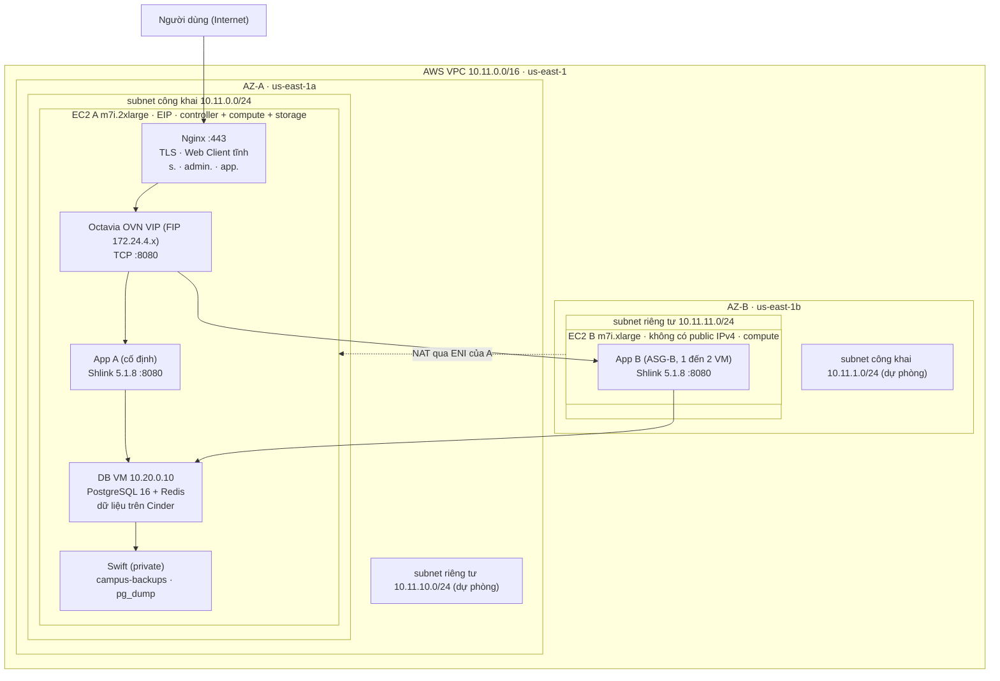

# Báo cáo CampusLink (Nhóm 11): các chương của TV1 (bản nháp 22/11/2026)

> **Trạng thái:** bản nháp của TV1 cho báo cáo cuối, gửi theo hạn 22/11 22:00 ở #74. Trạng thái từng hạng mục lấy từ `docs/acceptance.md` (TV4, bản v2 ngày 21/11), **trừ chỗ ghi "cập nhật sau 21/11"**. Mọi số liệu trỏ tới `evidence/...` trên `main` hoặc PR đang mở. `[CẦN KIỂM]` = cần đối chiếu nguồn trước khi nộp; `[TV1 điền]` = thông tin không có trong repo. Chưa ghi "đạt" khi chưa có evidence.
>
> **Phạm vi file này:** chương 0 đến 4, 5.1, 5.2, 5.5, 5.7b, 8 (rủi ro), 9 đến 12 theo khung báo cáo. Chương 5.3, 5.4, 7 (TV3), 5.6, 5.7, 5.8 (TV2), 6, 8 chi phí, Phụ lục A (TV4) do từng người viết.

## 0. Thông tin nhóm

Nhóm 11, lớp INT 3319 3. Phân công theo `docs/SRS.md` mục 6.1:

| Thành viên | Họ tên | Mảng phụ trách | Mã sinh viên |
| --- | --- | --- | --- |
| TV1 | Lương Đức Kiên | Nền tảng AWS + DevStack: mạng, IAM, ingress/TLS, Keystone, Cinder/Swift, runbook, khôi phục thảm họa | `[TV1 điền]` |
| TV2 | Nguyễn Công Huy Hoàng | Cân bằng tải, image, Heat, tự động co giãn, alarm | `[TV1 điền]` |
| TV3 | Đinh Quang Huy | Ứng dụng Shlink, PostgreSQL/Redis, sao lưu, portal Compose | `[TV1 điền]` |
| TV4 | Cao Song Toàn | Kiểm thử, hiệu năng, chi phí, ma trận nghiệm thu | `[TV1 điền]` |

Nhóm trưởng: `[TV1 điền]`. Mã nguồn, cấu hình, evidence: repo `luongkien25/campuslink`.

## 1. Tên dự án và bài toán

**CampusLink** là dịch vụ rút gọn link cho ban tổ chức sự kiện của trường: tạo link ngắn và mã QR, đổi đích đến, gắn tag theo chiến dịch, xem lượt truy cập. Ứng dụng là **Shlink 5.1.8** (backend) và **Shlink Web Client 4.8.1**, không sửa mã nguồn upstream (`docs/SRS.md` mục 1, C-04). Trọng tâm của bài tập là **hạ tầng cloud**: ứng dụng chạy trong máy ảo Nova trên **OpenStack DevStack stable/2026.1**, dựng lồng trong **2 máy EC2 ở 2 AZ** của AWS (us-east-1), để tự dựng các thành phần tương đương dịch vụ AWS (mạng, LB, tự động mở rộng, lưu trữ block và object, CSDL, giám sát).

- **Người dùng:** người truy cập link ngắn/QR; quản trị nội dung (CLB, đơn vị) dùng Web Client với API key riêng; thành viên nhóm vận hành qua SSH và CLI; script kiểm thử gọi REST bằng `X-Api-Key` (`docs/SRS.md` mục 2, bảng tác nhân).
- **Nhận xét của giảng viên (SRS O-04):** ngày 02/11/2026 thầy duyệt đề tài **Đạt**, nhận xét "ứng dụng có vẻ quá đơn giản" và "cần đánh giá thêm khi demo trình bày trực tiếp". Nhóm đáp lại bằng hai hướng: mở rộng ứng dụng bằng dịch vụ bao quanh Shlink (SRS mục 3.3, ADR-08) và tách riêng Load Balancing, Auto Scaling cùng mục đánh giá rủi ro trong báo cáo.

**Phạm vi đã rút (nói thẳng):**

- Phần mở rộng ứng dụng dừng ở **MVP chạy trên Compose** theo điều kiện lùi cứng ở #40 (SRS mục 6.3, PR #73): `campus-portal` không phát hành image lên registry và không lên cụm; FR-APP-15, 17, 20 bỏ khỏi MVP; `campus-stats` và `campus-worker` (FR-APP-18, 19, 21) không build; NFR-19 rút. Trên cụm chỉ còn phần đã dựng sẵn: DB `campus_portal`, hai secret trong Swift, `campus-svc` ghi `campus-qr`.
- FR-INF-25 tầng 3 chạy **bản thay thế không dùng S3** (dump về máy nhóm, khôi phục vào Compose mới), vì S3 Object Lock cần đổi ràng buộc ngân sách và ADR-11/O-22 chưa được nhóm duyệt.
- FR-INF-23 chỉ có quét secret (gitleaks) và Trivy/SBOM cho digest Shlink; **không ký cosign**.
- NFR-04 (so sánh có và không tự scale, từ 3 lượt) chưa làm. NFR-01 chưa đạt theo định nghĩa SRS (chương 6 của TV4).

## 2. Sơ đồ kiến trúc

### 2.1 Mạng AWS (hạng mục 1, FR-INF-01 đến 04)

VPC `campus-vpc` **10.11.0.0/16** ở us-east-1, 2 AZ, mỗi AZ một subnet công khai và một subnet riêng tư (`docs/inventory.yaml`):

| Subnet | CIDR | AZ | Dùng cho |
| --- | --- | --- | --- |
| public-a | 10.11.0.0/24 | us-east-1a (`use1-az1`) | **Host A** (m7i.2xlarge, 10.11.0.10, có Elastic IP): controller, compute, gateway, Cinder/Swift, Nginx :443, NAT cho B |
| private-a | 10.11.10.0/24 | us-east-1a | dự phòng, chưa dùng |
| public-b | 10.11.1.0/24 | us-east-1b (`use1-az2`) | dự phòng, chưa dùng |
| private-b | 10.11.11.0/24 | us-east-1b | **Host B** (m7i.xlarge, 10.11.11.10): compute, **không có public IPv4** |

Host B ra Internet qua route mặc định của route table riêng trỏ tới ENI của host A (NAT bằng masquerade trên A). B vào bằng SSH ProxyJump qua A. Đây là điểm khác với mẫu production "mỗi AZ một NAT Gateway": nhóm chọn một NAT instance vì ngân sách (SRS C-08, `AGENTS.md` mục 3 cấm thêm dịch vụ AWS trả phí khác) và vì B cần A dù sao.

### 2.2 Mạng OpenStack và luồng dữ liệu

- `campus-net` **10.20.0.0/24** (MTU 1400, overlay Geneve trải trên cả A và B) cho VM ứng dụng và DB; mạng `public` **172.24.4.0/24** (br-ex trên A) giữ floating IP của VIP; Nova có hai AZ `campus-az-a` (host A) và `campus-az-b` (host B).
- **Luồng chính:** Người dùng → EIP AWS → Nginx trên A :443 (TLS Let's Encrypt; vhost `s.` redirect, `admin.` Web Client, `app.` portal) → floating IP của VIP :8080 → Octavia OVN (TCP, pool `SOURCE_IP_PORT`) → app VM A hoặc app VM B (Shlink :8080) → PostgreSQL 16 và Redis trên DB VM 10.20.0.10 (dữ liệu trên Cinder volume). Sao lưu: `pg_dump` mỗi giờ → Swift private → khôi phục vào DB tách biệt.
- App VM và DB VM **không có floating IP**; cổng ra Internet duy nhất là Nginx :443 (cộng cổng 22 theo ADR-07, xem mục 5.2).

### 2.3 Sơ đồ

> **Lưu ý:** hình `docs/images/kien-truc.png` trong repo là bản cũ: chưa vẽ subnet công khai/riêng tư (đề bài yêu cầu có VPC, subnet, 2 AZ, thành phần, luồng dữ liệu) và còn vẽ `campus-portal`, `campus-worker`, `campus-stats` chạy trên cụm, trong khi phạm vi cuối chỉ có Shlink trên cụm (mục 1). Bản dưới đây là bản sửa (Mermaid, GitHub tự vẽ). `[TV1: xuất PNG và thay hình cũ trước khi nộp]`.

### 2.4 Giới hạn của kiến trúc

Control plane, Nginx, Swift, Cinder, gateway và DB đều ở host A, nên hai AZ chỉ chịu được lỗi tầng compute/ứng dụng (ví dụ mất app VM A: LB chuyển sang B, số đo ở chương 5.6 của TV2), **không chịu được mất cả AZ-A** (SRS mục 2, "Giả định và giới hạn đã chấp nhận"). Octavia OVN chỉ có health monitor TCP, không phát hiện API trả 500, nên readiness HTTP được kiểm trước khi đăng ký member.

## 3. Bảng đối chiếu 8 hạng mục bắt buộc

Trạng thái lấy từ `docs/acceptance.md` v2 (TV4); cột "Ghi chú" nêu chỗ đã cập nhật hoặc còn hạn chế. Đường dẫn evidence là thư mục `evidence/` trên `main` trừ khi ghi PR.

| # | Hạng mục (đề bài) | Tương đương AWS | OpenStack tự dựng (trọng tâm) | AWS làm lớp nền | Evidence chính | Trạng thái | Ghi chú |
| --- | --- | --- | --- | --- | --- | --- | --- |
| 1 | Mạng riêng, subnet công khai + riêng tư, ≥ 2 AZ | VPC, subnet, route table, NAT | Neutron + OVN: `campus-net` (mạng riêng), mạng `public` (chỉ giữ floating IP của VIP), router SNAT; hai AZ Nova `campus-az-a`, `campus-az-b` | VPC `10.11.0.0/16`, 4 subnet ở 2 AZ, NAT qua host A | `G0/20261023-FR-INF-01-*`, `G1/20261024-FR-INF-03-04-az-campus-net-vm-thu.txt` | **Đạt** | `FR-INF-01` đến `04` |
| 2 | App server trong subnet riêng, không ra Internet trực tiếp | Subnet riêng tư + security group | VM app và DB trong `campus-net`, không floating IP; chỉ floating IP của VIP; Nginx A:443 là cổng duy nhất | Security group; host B không public IPv4 | `G3/20261027-FR-INF-05-quet-cong-tu-ngoai.txt`, `G3/20261027-FR-INF-06-NFR-10-nginx-tls-letsencrypt.txt`, `G3/20261120-NFR-10-ssllabs-s-hang-a-an-ket-qua.txt` | **Đạt một phần** | Cert hợp lệ, SSL Labs hạng A; **SG cổng 22 của host A chưa thu về `/32`** (mục 5.2); ZAP chưa chạy |
| 3 | ≥ 2 loại lưu trữ + lý do chọn | EBS (block), S3 (object) | Cinder LVM (block), Swift (object) | EBS gp3 làm đĩa nền (root, volume cho Cinder) | `G1/20261025-FR-INF-13-14-12-cinder-swift-db-port.txt` | **Đạt** | Lý do chọn: chương 4 và 5.3 (TV3). `FR-APP-16` đạt trên Compose |
| 4 | CSDL + lý giải | RDS (PostgreSQL), ElastiCache (Redis) | PostgreSQL 16 + Redis tự dựng trên DB VM, dữ liệu trên volume Cinder | (không dùng RDS) | `G3/20261112-FR-INF-15-16-backup-restore-cum.txt`, `G3/20261116-FR-INF-16-H5-fixture-restore-cum.txt` | **Đạt** | `FR-INF-25` và `NFR-20` đạt một phần (tầng 3 bản thay thế, chương 7 của TV3) |
| 5 | Phân quyền bằng IAM role, không nhúng khóa | IAM role và policy | Keystone RBAC, application credential có access rules, Swift ACL | IAM role `CampusLinkBackup` gắn EC2 A, IMDSv2 hop 1, user thành viên chỉ Start/Stop | `G2/20261026-FR-INF-17-iam-role-campuslink-backup.txt`, `G1/20261025-FR-INF-18-keystone-rbac.txt`, `G3/20261107-ADR-10-kiem-tren-cum.txt` | **Đạt**, có giới hạn | Giới hạn `TOKEN_SIGNAL` 5.1 và `O-14` (mục 5.5) |
| 6 | LB + tự động mở rộng, **demo khi tải tăng** | Elastic Load Balancing, Auto Scaling | Octavia provider `ovn`; Heat AutoScalingGroup + Aodh + Gnocchi | (không dùng ELB/ASG của AWS) | `G1/20261025-FR-INF-07-smoke-ovn-lb.txt`; lượt tự scale 21/11: PR #91 | **Đạt một phần** | **Cập nhật sau 21/11:** `FR-INF-11` đạt các mốc tải → ALARM → Heat event → VM ready ở cả hai chiều tự động (lượt tối 21/11); thiếu mốc "request đầu tiên tới VM mới" (`NFR-06`). `acceptance.md` v2 viết "chưa bật `alarm_actions`" là **lỗi thời** so với lượt này (mục 5.7b) |
| 7 | Giám sát, ≥ 1 cảnh báo cấu hình và kích hoạt thử | CloudWatch (metric và alarm) | Ceilometer + Gnocchi + Aodh | (không dùng CloudWatch) | `G4/20261114-FR-INF-10-tv2-metric-alarm.txt` (alarm `ok → alarm` dưới tải thật) | **Đạt** | Chương 5.8 (TV2) |
| 8 | Bảng chi phí vận hành hàng tháng nếu chạy thật | AWS Pricing Calculator, Budgets | (không áp dụng) | Budgets 30/50/65 USD, Calculator | `evidence/cost.csv`, `G0/20261118-FR-INF-21-aws-credits.png`, `G0/20261119-FR-INF-21-aws-budgets.png` | **Đạt** | Chương 8 chi phí (TV4) |

Cột "Tương đương AWS" là dịch vụ AWS mà thành phần OpenStack tự dựng thay thế; nhóm nêu rõ để áp dụng điểm cộng OpenStack ở mục 3 của đề (OpenStack được +2 điểm nếu tự dựng được các thành phần tương đương và nêu rõ).

## 4. Lý giải lựa chọn công nghệ

**Đây là dự án OpenStack.** Nhóm tự dựng các thành phần tương đương dịch vụ AWS trên OpenStack; AWS chỉ là lớp nền cho hai máy EC2. Đề bài mục 2 yêu cầu nhóm tự tay dựng hạ tầng, và mục 3 cho OpenStack +2 điểm nếu tự dựng được các thành phần tương đương và nêu rõ (bảng ở chương 3).

Mỗi dòng: lựa chọn, phương án đã cân nhắc, lý do (kèm nguồn), hệ quả. Nguồn "Phân công" là `docs/references/Phan_cong_Nhom_11_CampusLink.pdf` (bản 1.2, 22/10/2026), mục 1.1, 1.2 (ADR-01 đến 06) và mục 9. Chỗ chưa tìm được nguồn trong ADR, SRS hay tài liệu phân công ghi `[CẦN KIỂM nguồn]`, không suy diễn.

| Lựa chọn | Đã cân nhắc | Lý do (nguồn) | Hệ quả và giới hạn |
| --- | --- | --- | --- |
| **OpenStack DevStack stable/2026.1** tự dựng trên 2 EC2 m7i, AWS làm lớp nền | Dùng thẳng dịch vụ AWS (ALB, RDS, ElastiCache, S3, CloudWatch); Kolla-Ansible thay DevStack | Đề bài mục 2 và 3 (xem trên); ngân sách lab ≤ 70 USD (SRS C-08) và `AGENTS.md` mục 3 không cho thêm dịch vụ AWS trả phí. DevStack: "nhóm đã quen, cài trên máy sạch", chốt SHA từng repo (Phân công 1.1). Kolla-Ansible "phù hợp vận hành hơn nhưng cần inventory, mạng, container mới", phải quyết sớm trước 25/10 (Phân công mục 9) | DevStack là bản cho lab, "không xem DevStack là nền sản xuất" (Phân công 1.1); chạy lại `stack.sh` xóa toàn bộ cụm (ADR-11); nested KVM trên m7i, đã xác minh KVM trên cả hai máy (`G0/20261023-FR-INF-02-campus-a-kvm.png`, `G0/20261023-FR-INF-02-campus-b-kvm.png`) |
| **Neutron ML2/OVN, Octavia provider `ovn`** (TCP, không Amphora) | Amphora | "Geneve nối hai compute; TCP LB không cần Amphora VM" (Phân công 1.1). Amphora "hỗ trợ chức năng rộng hơn nhưng thêm image, mạng quản lý và RAM", chỉ đổi khi đủ tài nguyên (Phân công mục 9); quota project chỉ 8 vCPU và 12 GiB RAM (SRS C-07) | Chỉ health monitor TCP, "không biết API trả 500" (Phân công 1.1), nên readiness HTTP được kiểm trước khi đăng ký member; không L7, không TLS ở Octavia (TLS ở Nginx) |
| **Heat AutoScalingGroup + Ceilometer + Gnocchi + Aodh** | Kubernetes, Magnum; Senlin | "Một chuỗi gồm tạo tài nguyên, thu số đo, lưu số đo, đánh giá ngưỡng" và "không thêm Kubernetes/Magnum cho phạm vi này" (Phân công 1.1); bật dịch vụ DevStack mới phải chạy lại `stack.sh` (ADR-11). Lý do không chọn Senlin: `[CẦN KIỂM nguồn]` | Phụ thuộc bản vá Aodh (ADR-12, mục 5.7b); "không coi cài được API là autoscaling đã chạy" (Phân công 1.1) |
| **Cinder (block) và Swift (object)** | Chỉ một loại lưu trữ | DB cần đĩa block tách khỏi root disk để tránh mất gắn sau reboot (Phân công ADR-04); dump, thẻ QR, báo cáo, secret cần object có quyền theo token (ADR-10, SRS FR-INF-13, 14). Chi tiết: chương 5.3 (TV3) | "Một host storage không chịu được mất host/AZ" (Phân công 1.1): Swift nằm trên host A; bù bằng bản dump kéo về máy nhóm (tầng 3) |
| **PostgreSQL 16 và Redis tự dựng trên DB VM** (dữ liệu trên Cinder) | Dịch vụ CSDL quản trị sẵn: Trove (OpenStack), RDS và ElastiCache (AWS) | Mọi replica dùng chung một DB và một Redis; không SQLite khi nhiều replica (Phân công ADR-03, SRS C-05). Trove không cài vì thêm dịch vụ DevStack mới phải chạy lại `stack.sh` và xóa cả cụm (ADR-11); RDS, ElastiCache bị loại bởi ràng buộc ngân sách (`AGENTS.md` mục 3) | Nhóm tự vận hành backup, vá, giám sát (chương 5.4 và 7 của TV3) |
| **SSH cổng 22 mở `0.0.0.0/0` có điều kiện** (ADR-07) | Chỉ mở `/32` từng người | IP nhà và wifi trường của thành viên đổi thường xuyên, mỗi lần đổi phải chờ TV1 sửa SG, làm chậm cả nhóm (ADR-07 mục Bối cảnh). Bù bằng: chỉ đăng nhập bằng key, `fail2ban` jail `sshd`, mỗi người một user Linux không sudo, B không public IPv4 | Tạm thời: đã định thu về `/32` trước freeze; **trạng thái lúc nộp: mục 5.2** |
| **Secret qua Swift `campus-secrets` + application credential `campus-boot` chỉ-đọc** (ADR-10) | Kéo secret từ DB VM qua mạng nội bộ; secret trong user-data hay Heat parameter; bake vào image Glance; Barbican; trình quản lý mật khẩu chung | VM do ASG tạo không có người nhập tay và không có floating IP nên cần thứ chứng minh quyền lấy secret; user-data lộ qua `stack show`; bake image đi ngược FR-INF-22; Barbican không thuộc bộ thành phần đã chốt (ADR-10 mục "Phương án đã loại") | Cần ngoại lệ NFR-08 hẹp, ghi trong SRS; ACL của Swift áp cho cả container nên `campus-boot` đọc được mọi object trong `campus-secrets` (ADR-10 mục 5); lộ credential coi như lộ mọi secret trong container |
| **Let's Encrypt + sslip.io** | Mua domain | Nhóm không mua domain; `<EIP-gạch-ngang>.sslip.io` là DNS công khai miễn phí (SRS mục 2, "Domain") | Phụ thuộc giới hạn tần suất cấp cert của sslip.io (SRS O-01) |
| **Bản vá Aodh tính `rate:mean` từng VM** (ADR-12) | Giữ Aodh nguyên bản; hạ ngưỡng; CPU giả; signal tay | Aodh nguyên bản tính hiệu của trung bình counter, sai khi tập VM đổi giữa hai bucket (ADR-12 mục Bối cảnh, đã đo 15/11). Không tạo tác vụ CPU giả để ép chứng minh scaling (Phân công ADR-06) | Vá mã dịch vụ nền cục bộ trên host A; mất khi chạy lại `stack.sh`; **không đổi ngưỡng** NFR-05 |

Mỗi thành viên phụ trách một mảng và phải giải thích được lý do của mảng đó ở buổi bảo vệ (mục 12).

## 5. Chi tiết kỹ thuật phần TV1

Mỗi mục: thiết kế, cách kiểm, số đo, evidence, giới hạn.

### 5.1 Mạng 2 AZ (FR-INF-01 đến 04)

- **Thiết kế:** mục 2.1 và 2.2. Nested KVM bắt buộc trên cả hai host (không benchmark trên QEMU, SRS C-02).
- **Cách kiểm và kết quả** (`docs/acceptance.md` hạng mục 1): hai EC2 ở hai AZ ID khác nhau; B không có public IPv4 và ra Internet qua NAT trên A; `/dev/kvm` và `kvm-ok` trên cả hai host; hai `nova-compute` up, aggregate `campus-az-a`/`campus-az-b` ánh xạ đúng host; `campus-net` ping với cờ DF 1372 byte và HTTP xuyên host qua Geneve; VM ra Internet qua SNAT. Sau một lần Stop/Start thật của hai EC2 (24/10), hostname, đĩa Cinder (by-id), volume group, đồng bộ giờ và NAT vẫn đúng trên A và B (`G1/20261024-FR-INF-02-sau-stop-start.txt`).
- **Evidence:** `G0/20261023-FR-INF-01-*` (ảnh Console, route table, NAT, B ra Internet, ProxyJump), `G0/20261023-FR-INF-02-campus-a-kvm.png`, `G0/20261023-FR-INF-02-campus-b-kvm.png`, `G1/20261024-FR-INF-02-sau-stop-start.txt`, `G1/20261024-FR-INF-03-04-az-campus-net-vm-thu.txt`.
- **Giới hạn:** mục 2.4 (host A là điểm lỗi chung); hai subnet dự phòng (private-a, public-b) tạo sẵn nhưng chưa dùng.

### 5.2 Ứng dụng private và ingress (FR-INF-05, 06, NFR-10)

- **Thiết kế:** app/DB VM không floating IP; security group `campus-app-sg` chỉ cho 8080 (và 8081 cho portal) từ `campus-net` và dải `172.24.4.0/24`; DB chỉ nhận kết nối từ `campus-net`; cổng 5432, 6379 và API quản trị OpenStack không ra ngoài VPC. Nginx trên A :443 là điểm vào duy nhất, chứng thư Let's Encrypt có SAN `s.`, `admin.`, `app.`. Cổng 80 trên A là Apache của DevStack nên chỉ mở vài phút khi cấp cert.
- **Kết quả:** quét cổng từ ngoài chỉ thấy 443 (cộng 22, xem dưới); `https://s.<domain>/rest/health` và `https://admin.<domain>/` trả 200 với cert hợp lệ, không dùng `curl -k`; cert hợp lệ tới 05/02/2027; **SSL Labs hạng A** ngày 20/11 (kết quả ẩn; PR #88). Nginx ghi log `$request_time` cho SLI (NFR-22).
- **Evidence:** `G3/20261027-FR-INF-05-quet-cong-tu-ngoai.txt`, `G3/20261109-FR-INF-19-FR-INF-05-after-start-co-B-quet-cong.txt`, `G3/20261027-FR-INF-06-NFR-10-nginx-tls-letsencrypt.txt`, `G3/20261108-FR-INF-06-cert-them-app.txt`, `G3/20261114-FR-INF-06-NFR-22-nginx-noi-vip-va-kiem-1-7b.txt`, `G3/20261120-NFR-10-ssllabs-s-hang-a-an-ket-qua.txt`.
- **Trạng thái SG cổng 22 (nói đúng thực tế):** theo ADR-07, cổng 22 mở `0.0.0.0/0` tới freeze rồi thu về `/32`. Ngày 19/11 đã thử thu và TV4 quét ngoài chỉ thấy 443, nhưng sau đó mở lại `0.0.0.0/0` để thành viên SSH làm việc; **chưa có file evidence `/32` trong repo** và trạng thái SG hiện tại vẫn là `0.0.0.0/0` (`docs/acceptance.md` hạng mục 2). Lúc nộp: `[TV1 điền: đã thu /32 (kèm ảnh Console và giờ CloudTrail) hoặc giữ 0.0.0.0/0 và nêu rõ lý do]`. Chừng nào chưa có evidence thì báo cáo không ghi "22 chỉ `/32`".
- **Chưa làm:** OWASP ZAP baseline của NFR-10 (TV4 chưa chạy).

### 5.5 IAM và phân quyền (FR-INF-17, 18, NFR-08, 09)

Ba lớp quyền độc lập:

1. **AWS IAM** (FR-INF-17, NFR-09): role `CampusLinkBackup` gắn vào EC2 A, quyền hẹp: dry-run `CreateSnapshot` trên volume Cinder của A cho `DryRunOperation`, trên volume của B cho `UnauthorizedOperation`, và một snapshot thật `completed`. IMDSv2 hop limit 1, nên VM guest không lấy được credential của role. User thành viên chỉ Start/Stop các máy có tag `Project=CampusLink`, không có `ec2:CreateTags`.
2. **Keystone và Swift** (FR-INF-18, ADR-10): `campus-tv2` và `campus-tv3` là `member` (tạo tài nguyên trong project `campuslink`, tạo project bị 403); `campus-tv4` là `reader` (tạo VM hoặc object bị 403); user Linux thường không đọc được `openrc` admin. Application credential `campus-boot` (một rule GET trên `campus-secrets/app/*`) và `campus-svc` (10 rule trên `campus-qr`, `campus-reports`) có **access rules** (O-14).
3. **Shlink API key** (FR-APP-07, 08): không key hoặc key sai trả 401; key `--author-only` của đơn vị B không đọc, không sửa, không thấy link của đơn vị A (smoke H1 trên cụm 18/11: 27 PASS, 0 FAIL).

- **Evidence:** `G0/20261023-FR-INF-17-launch-a-no-iam-profile.png`, `G0/20261023-NFR-09-launch-a-imdsv2-hop1.png`, `G0/20261023-NFR-16-iam-campuslink-startstop-policy.png`, `G2/20261026-FR-INF-17-iam-role-campuslink-backup.txt`, `G1/20261025-FR-INF-18-keystone-rbac.txt`, `G2/20261026-FR-INF-18-lo-quyen-admin-va-thu-member.txt`, `G2/20261027-NFR-09-guest-khong-lay-duoc-credential-iam.txt`, `G3/20261107-ADR-10-kiem-tren-cum.txt`, `G3/20261107-H3b-campus-svc-access-rules.txt`, `G3/20261118-FR-APP-01-12-h1-smoke-cum.txt`.
- **Giới hạn đã ghi nhận:**
  - Phép thử `TOKEN_SIGNAL` của Heat `WaitConditionHandle` (26 PASS, 1 FAIL): role `reader` (`campus-tv4`) đọc được attribute `token` của stack qua Heat API; token thuộc `heat_stack_user` chỉ có quyền gửi signal (403 ở Heat, Swift, Keystone, Nova). Evidence `G3/20261112-FR-INF-09-NFR-08-heat-token-signal-kiem-tren-cum.txt`.
  - `O-14` còn mở một phần: `campus-svc` đã kiểm access rules trên A và dùng thử từ DB VM, chưa thử từ container portal hoặc worker chạy thật trên cụm vì portal dừng ở Compose (#40).
  - IMDSv2 hop 1 chặn guest, **không** chặn chính host A đọc credential của role (host vẫn đọc được qua IMDS); vì vậy quyền của role được giữ hẹp.
  - Role AWS hiện chỉ dùng để chứng minh phân quyền (dry-run, một snapshot thật) và để kiểm sau mỗi lần bật (`docs/runbooks/after-start.md`, `aws sts get-caller-identity`); không có script nào gọi role định kỳ. Snapshot EBS định kỳ do DLM tạo; backup DB hằng giờ đi qua Swift bằng credential Keystone. Phần quyền chạy thật của dự án nằm chủ yếu ở Keystone và Swift (OpenStack).
  - NFR-08 cấm secret trong user-data nhưng ADR-10 mục 9 ghi ngoại lệ hẹp cho `campus-boot` và (bổ sung 10/11) mật khẩu DB/Redis trong user-data của DB VM.
  - Ảnh Console ngày 22/11 (chưa lưu vào repo): `luongkien25` bật passkey, ba user `tv2`, `tv3`, `tv4` chưa hiện MFA. `[CẦN KIỂM]` trước khi đưa vào báo cáo.

### 5.7b Vì sao có bản vá Aodh và cách kiểm (phần TV1 của chương tự động co giãn)

- **Vấn đề** (ADR-12, đã đo 15/11): alarm CPU dùng `gnocchi_aggregation_by_resources_threshold` với `rate:mean`, nhưng Aodh nguyên bản tính hiệu của **trung bình counter** các VM; khi tập VM đổi giữa hai bucket (VM mới tham gia, VM chưa ghi điểm) giá trị lệch, có cả giá trị âm, và alarm low có thể sang ALARM sai.
- **Bản vá** (ADR-12, áp trên host A ngày 17/11): lấy rate từng VM rồi mới trung bình, chỉ sửa lớp evaluator của Aodh (10 dòng thêm, 5 xóa), không đổi ngưỡng 60%/25%, granularity, số cửa sổ hay cooldown; NFR-05 giữ nguyên.
- **Gate dữ liệu v2** (PR #81, chưa merge lúc viết): evaluator tự từ chối cửa sổ dữ liệu không đáng tin (nhãn `campus-gate reject=...` trong journal) và chuyển alarm sang `insufficient data` thay vì quyết định sai. Lượt áp đầu (v2.1, 21/11 08:27Z) từ chối mọi cửa sổ với `bad_timestamp` vì `gnocchiclient` trả timestamp kiểu `datetime`, trong khi ADR v2.1 giả định chuỗi ISO và 19 ca test dùng Gnocchi giả nên không bắt được; v2.2 sửa và áp 09:38Z. Lượt chỉ-đánh-giá với actions rỗng (09:46 đến 10:12Z): `0` `bad_timestamp`, `0` Traceback; VM mới vào nhóm gây `gnocchi_400` rồi hồi phục sau vài phút; VM rời nhóm không bị từ chối. Evidence: PR #91 (`evidence/G4/20261121-FR-INF-11-gate-v21-bad-timestamp-aodh-evaluator-0844Z.txt`, `...-gate-v22-aodh-evaluator-0946Z.txt`, `...-gate-v22-alarm-history.txt`).
- **Kết quả tự scale (cập nhật sau 21/11, PR #91, `evidence/G4/20261121-FR-INF-11-tu-scale-aodh-heat-hai-chieu.txt`):** hai alarm bật action trên stack alarm riêng, không đụng stack core. Lượt 2 (slug mới, 0 visit): `cpu_high` ALARM 15:53:22Z → Heat `scale_out` 15:54:12Z → 3 member `ONLINE` 15:54:19Z; tải dừng 15:58:39Z → `cpu_low` ALARM 16:04:22Z → Heat `scale_in` 16:04:38Z → 2 member. Không gửi signal tay (theo TV2, JSON thô ở #77); journal notifier và evaluator không có 401, 403, error hay Traceback quanh hai lần ALARM (TV1 đọc chỉ-đọc).
- **Giới hạn:** chưa có mốc "request đầu tiên tới VM mới" cho lượt tự động; một lượt thành công, chưa lặp lại; lượt đầu cùng ngày (slug có khoảng 124 nghìn visit) không chạm 60% vì DB VM 1 vCPU bão hòa trước; giải thích theo số visit của slug (TV3, #89, #90) khớp số đo nhưng là **tương quan, chưa đối chứng**; bản vá là sửa cục bộ trên A, mất khi chạy lại `stack.sh`; không dùng CPU giả, signal tay hay hạ ngưỡng (SRS mục 5).

## 8. Đánh giá rủi ro (đề bài yêu cầu có mục này; phần chi phí do TV4)

Xác suất và tác động là **đánh giá của TV1**, không phải số đo.

| Rủi ro | Xác suất | Tác động | Đã làm | Còn lại |
| --- | --- | --- | --- | --- |
| Host A hỏng hoặc mất AZ-A (ingress, controller, DB, Swift cùng một máy) | Thấp | Rất cao: mất toàn hệ thống | Backup `pg_dump` hằng giờ vào Swift; snapshot Cinder (DR tầng 1, RTO 124 đến 158 s); bản dump kéo về máy nhóm (tầng 3 thay thế, RTO 18,2 s, PR #86); runbook `after-start` | Không chịu mất AZ-A; Swift nằm trên A; tầng 3 không bất biến (không Object Lock) |
| DB VM 1 vCPU bão hòa dưới tải | Cao (đã xảy ra) | Cao: p95 tăng, NFR-01 chưa đạt, ngăn CPU nhóm app chạm ngưỡng scale | Đo và truy nguyên nhân (#76, PR #84, #89); lượt đo chỉ-đọc không đổi cấu hình trong freeze | Hướng sửa để sau bản nộp: giữ kết nối lâu dài hoặc pgbouncer, tăng vCPU DB, bỏ pub/sub khi không có `campus-stats` |
| Aodh tính sai hoặc dữ liệu thiếu dẫn tới scale sai | Trung bình | Trung bình: scale nhầm hoặc kẹt `insufficient data` | ADR-12, gate v2.2 chỉ-đánh-giá rồi bật action có kiểm soát; hai alarm tắt khi không dùng | Bản vá cục bộ; một lượt tự động thành công; đường trust đã chạy một lượt |
| Cụm tắt không sạch hoặc bật lại thiếu dịch vụ | Trung bình | Trung bình: mất thời gian demo, nguy cơ dữ liệu | Runbook `after-start` bắt buộc Phần 1 và 2, `campus-check`, Stop B rồi A | Phụ thuộc quy trình thủ công |
| Lộ secret hoặc Account ID trong evidence, video | Trung bình | Cao | `gitleaks` chạy mọi PR; secret qua Swift (ADR-10); che ảnh và output trước khi đăng; quét tay mỗi PR evidence | Ảnh evidence G0 chưa ai soát hết `[CẦN KIỂM]`; ảnh Billing có Account ID phải che trước khi dùng |
| SSH cổng 22 mở `0.0.0.0/0` | Cao (đang xảy ra, ADR-07) | Trung bình | Chỉ key, `fail2ban`, user riêng không sudo, B không public IPv4 | Chưa thu về `/32` (mục 5.2) |
| Lộ credential `campus-boot` | Thấp | Cao: lộ mọi secret trong `campus-secrets` | Access rules chỉ GET; quy trình xoay vòng ở ADR-10 mục 10 | ACL cấp container, không cấp prefix |
| Chi phí vượt ngân sách | Thấp | Trung bình | Budgets 30/50/65 USD; tự tắt sau 60 phút rảnh; lịch tắt 02:00; chỉ bật theo phiên | Số liệu chi phí: chương 8 của TV4 |

## 9. Đánh giá theo 6 trụ cột AWS Well-Architected

| Trụ cột | Đã làm | Giới hạn thật |
| --- | --- | --- |
| Vận hành | Runbook bật/tắt và kiểm sau khi bật, ADR, nhật ký cloud (#4), hộp yêu cầu bằng issue, `campus-check`, CI quét secret và Trivy | Phần lớn vận hành thủ công; CI không chạy test trong `tests/` |
| Bảo mật | SG tối thiểu, SSH chỉ key và fail2ban (ADR-07), IAM role quyền hẹp, IMDSv2 hop 1, Keystone RBAC, Swift private, application credential có access rules (ADR-10), TLS Let's Encrypt (SSL Labs A), gitleaks | SSH 22 từng và đang mở `0.0.0.0/0` (mục 5.2); host đọc được credential role qua IMDS; ngoại lệ NFR-08; `TOKEN_SIGNAL` 5.1 FAIL |
| Tin cậy | 2 AZ cho app, LB health monitor, failover đo được, backup hằng giờ, DR tầng 1 và 2 | Control plane và Nginx chỉ ở host A; failover một lượt ở 10 RPS |
| Hiệu năng | Đo tải 10 và 30 RPS, `$request_time`, scale tay 2→3→2, tự scale hai chiều một lượt | NFR-01 chưa đạt; DB VM 1 vCPU; tương quan chưa đối chứng |
| Chi phí | Start/Stop theo phiên, tự tắt, Budgets, so sánh AWS managed | Số giờ chạy thực tế: chương 8 của TV4 |
| Bền vững | Chỉ chạy khi cần | Không có số đo năng lượng: ghi "chưa đo", không suy diễn |

## 10. Giới hạn trung thực

Mỗi dòng dẫn nguồn:

- NFR-01 chưa đạt theo định nghĩa SRS; NFR-03 thiếu 60 RPS; NFR-04 chưa làm (chương 6, TV4).
- Tự scale (FR-INF-11): đạt các mốc tải → ALARM → Heat → VM ready ở cả hai chiều trong **một** lượt (21/11, PR #91); thiếu mốc request đầu tiên tới VM mới; lượt đầu cùng ngày không chạm 60%; chưa lặp lại.
- FR-INF-25 tầng 3 không S3 (O-22 chưa duyệt); FR-INF-23 không ký cosign.
- Portal chỉ chạy trên Compose; `campus-worker`, `campus-stats` không build (#40, PR #73).
- Failover app VM chỉ đo một lượt ở 10 RPS (chương 5.6, TV2).
- p95 phía server 596 ms ngày 18/11: nguyên nhân chưa chứng minh (tương quan với kết nối PostgreSQL mới mỗi request, #76, #89).
- SG cổng 22: chưa có evidence `/32` (mục 5.2).
- `O-14` chưa thử từ container portal/worker thật; `TOKEN_SIGNAL` 5.1 FAIL (mục 5.5).
- Gate Aodh v2.2 đang chạy trên host A nhưng **chưa nằm trên `main`** (PR #81 chờ review của TV2); `infra/devstack/patches/` mới có bản vá v1. Cấu hình chạy thật vì vậy chưa có đủ trong mã đã nộp cho tới khi #81 được merge.
- Quy trình dựng DevStack từ đầu (`stack.sh` từng bước) nằm ở tài liệu nội bộ "Lab TV1", ngoài repo (`README.md` mục "Dựng lại từ đầu"); repo chỉ có `A.local.conf.example`, `B.local.conf.example`, runbook và các bàn giao H2 đến H4.
- DevStack là bản cài cho lab, không phải nền sản xuất (tài liệu phân công 1.1); cụm chỉ có hai node, host A là điểm lỗi chung (SRS mục 2, ADR-05 trong tài liệu phân công).
- Ảnh evidence G0 chưa ai soát hết.

## 11. Kịch bản demo mười phút

`[TV1: ghép từ kịch bản demo 10 phút sau khi video chốt]`. Mỗi bước nêu: thao tác sẽ làm và kết quả mong đợi, cho cả 8 hạng mục trong 10 phút (tiêu chí 4 của đề); dùng chung cho video và buổi bảo vệ 30/11. Bước nào không chạy trực tiếp được thì dùng evidence có sẵn và ghi rõ.

## 12. Phân công và đóng góp của TV1

**Mảng:** hạ tầng AWS và nền DevStack. Việc thật (SRS mục 6.1: FR-INF-01 đến 06, 13, 14, 17 đến 19, 23 đến 25; NFR-09, 10, 13, 20):

- Mạng AWS và 2 EC2 (VPC, subnet, route table, NAT qua A), SG, ingress Nginx và TLS Let's Encrypt, SSH theo ADR-07.
- Dựng và quản trị Keystone, Cinder LVM, Swift; project `campuslink` và quyền cho TV2, TV3, TV4 (RBAC); IAM role `CampusLinkBackup`.
- Cấp secret và credential hẹp (ADR-10: `campus-boot`, `campus-svc`).
- Runbook bật/tắt, `after-start`, `freeze`; nhật ký cloud (#4); DR tầng 1 và 2 (FR-INF-25); quét secret và Trivy (FR-INF-23).
- Bản vá và gate Aodh (ADR-12, PR #81); điều phối các PR và issue của nhóm; ghép báo cáo.

**Ba câu có thể bị hỏi ở buổi bảo vệ, kèm hướng trả lời:**

1. *Vì sao mở SSH `0.0.0.0/0` và bù bằng gì?* IP thành viên đổi liên tục, chờ sửa SG làm chậm cả nhóm; bù bằng chỉ key, `fail2ban`, user riêng không sudo, B không public IPv4; đây là ngoại lệ tạm thời có ADR-07 và phải thu về `/32`; trạng thái thật lúc nộp ở mục 5.2.
2. *Vì sao VM do Auto Scaling tạo lấy secret từ Swift bằng application credential, không để trong user-data hay image?* VM mới không có người nhập và không có floating IP; user-data lộ qua `stack show`, bake vào image đi ngược FR-INF-22; credential `campus-boot` chỉ có quyền GET, có access rules; đổi lại cần ngoại lệ NFR-08 hẹp và ACL áp cho cả container (ADR-10).
3. *Vì sao vá Aodh và vì sao không hạ ngưỡng cho dễ scale?* Aodh nguyên bản tính sai rate khi tập VM đổi giữa hai bucket; bản vá tính rate từng VM và gate v2.2 từ chối dữ liệu không đáng tin; ngưỡng 60%/25% là yêu cầu NFR-05, hạ ngưỡng hay dùng CPU giả hay signal tay đều bị SRS mục 5 cấm vì không còn chứng minh được tự động co giãn.
